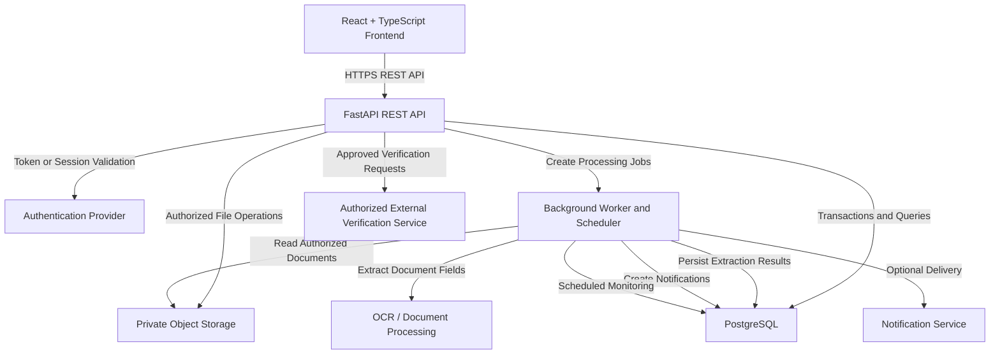

# API.md

# FDR-SMART — API Specification

## 1. Purpose

This document defines the REST API contract for FDR-SMART, a centralized portal for managing institution-wise and instrument-wise security deposits and Fixed Deposit Receipts (FDRs) for the AICTE Regulation Bureau.

The API connects the React and TypeScript frontend to the FastAPI backend and coordinates approved integrations with authentication providers, private document storage, document-processing services, notification services, and any officially authorized external verification systems.

The API supports the following user journeys:

1. Authenticate users and resolve their application permissions.
2. Register institutions and manage authorized institutional memberships.
3. Create, submit, view, and update financial instrument records.
4. Upload and securely retrieve supporting documents.
5. Process documents through OCR and review extracted information.
6. Review instruments, record verification outcomes, and resolve discrepancies.
7. Monitor maturity dates and manage renewal or replacement workflows.
8. Submit and review release/refund requests.
9. Deliver in-application notifications.
10. Generate authorized dashboards and reports.
11. Manage administrative operations and access audit history.

### Design principles

* Use REST conventions with predictable resource-oriented URLs.
* Use JSON for API requests and responses, except for file uploads and downloads.
* Enforce authentication, authorization, institution-level isolation, and workflow rules on the backend.
* Never trust client-supplied roles, permissions, institution ownership, verification status, or approval outcomes.
* Keep OCR extraction separate from independent verification.
* Record significant business transitions and security-relevant actions.
* Use consistent validation, error, pagination, and filtering conventions.
* Make retryable operations safe against accidental duplication.
* Do not expose credentials, private storage keys, or third-party secrets to the frontend.
* Integrate with external systems only through approved interfaces.
* Do not imply that an administrative approval represents an actual financial transfer.

---

# 2. API Architecture

## 2.1 Architecture overview

The application follows a modular-monolith architecture.



External verification and notification integrations are optional and must not be assumed available until approved.

## 2.2 Base URL

All application endpoints use the versioned prefix:

`/api/v1`

Examples:

* `/api/v1/me`
* `/api/v1/instruments`
* `/api/v1/documents`
* `/api/v1/verification/queue`

The production API must be served over HTTPS.

The actual hostname and deployment path are environment-specific and must not be hard-coded into frontend source files.

## 2.3 Content types

| Operation                    | Content type                                 |
| ---------------------------- | -------------------------------------------- |
| Standard API request         | `application/json`                           |
| Standard API response        | `application/json`                           |
| Multipart file upload        | `multipart/form-data`                        |
| Binary file download         | Appropriate validated media type             |
| Webhook request, if approved | Provider-defined content type, normally JSON |

## 2.4 HTTP conventions

| Method   | Intended use                                                                    |
| -------- | ------------------------------------------------------------------------------- |
| `GET`    | Retrieve resources or reports without changing business state                   |
| `POST`   | Create resources, submit workflows, or initiate actions                         |
| `PATCH`  | Partially update an editable resource                                           |
| `PUT`    | Replace a resource only where full replacement semantics are explicitly defined |
| `DELETE` | Delete an eligible resource only where deletion is explicitly permitted         |

Financial instrument submission, verification, approval, replacement, and release/refund decisions should use explicit workflow actions rather than allowing unrestricted changes to status fields.

---

# 3. Authentication and Authorization

## 3.1 Authentication

The application uses the approved organizational authentication provider.

The authentication provider establishes the user's identity. The FDR-SMART backend independently resolves the corresponding application user and checks application-specific permissions.

The `users` table stores the application profile and the provider subject identifier, not passwords or reusable authentication secrets.

The final authentication mechanism depends on the selected provider.

### Preferred session approach

Where supported by the approved identity provider and deployment architecture:

* Use secure, HTTP-only cookies for application sessions.
* Set the `Secure` attribute in production.
* Set an appropriate `SameSite` policy.
* Implement CSRF protection for state-changing requests authenticated by cookies.
* Define session expiration and revocation behavior.
* Never expose session secrets to JavaScript.

If the provider instead requires bearer-token authentication, the frontend must follow the provider's approved token-management approach. Tokens must not be embedded in source code, logged, or persisted in insecure browser storage.

## 3.2 Authentication endpoints

| Method | Endpoint          | Purpose                                                                                  | Access                                              |
| ------ | ----------------- | ---------------------------------------------------------------------------------------- | --------------------------------------------------- |
| `GET`  | `/auth/session`   | Return the current application session state, where session-based authentication is used | Public or authenticated, depending on session state |
| `POST` | `/auth/logout`    | End the current application session, where supported by the chosen authentication model  | Authenticated                                       |
| `GET`  | `/me`             | Return the authenticated user's application profile                                      | Authenticated                                       |
| `GET`  | `/me/permissions` | Return effective application permissions and authorized institution scope                | Authenticated                                       |

Login, password recovery, MFA, and identity-provider callbacks should be handled by the selected provider unless the approved architecture explicitly requires application-owned endpoints.

Do not create duplicate authentication functionality unnecessarily.

### `GET /api/v1/me`

Example response:

```json
{
  "id": "6dbb31a6-38f7-4ed6-a3d4-74f01824db26",
  "display_name": "Example User",
  "email": "user@example.org",
  "status": "active"
}
```

Only return fields needed by the frontend.

### `GET /api/v1/me/permissions`

Example response:

```json
{
  "roles": [
    "institution_representative"
  ],
  "permissions": [
    "instrument:read",
    "instrument:create",
    "instrument:submit",
    "document:upload"
  ],
  "institutions": [
    {
      "id": "2d2dd3c5-5b70-4a78-89d0-39b55d15a713",
      "name": "Example Institution"
    }
  ]
}
```

The response is informational for UI rendering. It does not replace backend authorization checks.

## 3.3 Application roles

The API recognizes the approved application roles:

* Institution representative
* Scrutiny officer
* Approving authority
* System administrator

The backend must apply role permissions, record-level access, institution ownership, and workflow-state rules together.

A role alone does not grant access to every record.

## 3.4 Authorization rules

The backend must enforce the following:

1. Resolve the authenticated provider subject to an active application user.
2. Reject disabled or suspended application accounts.
3. Resolve the user's active institution memberships and assigned administrative scope.
4. Verify access to the requested record.
5. Verify permission to perform the requested action.
6. Verify that the current workflow state allows the action.
7. Enforce separation-of-duties rules where required.
8. Record significant operations in the audit log.

For example, an institution representative cannot access another institution's FDR simply by guessing its UUID.

The backend must not rely on frontend route guards, hidden buttons, or client-supplied permission lists.

## 3.5 Unauthorized and forbidden requests

Use:

* `401 Unauthorized` when valid authentication is absent or invalid.
* `403 Forbidden` when the caller is authenticated but lacks the required permission.
* `404 Not Found` where returning `403` would unnecessarily reveal the existence of a protected resource, according to the approved security policy.

---

# 4. Standard Request and Response Conventions

## 4.1 Resource identifiers

All primary resource identifiers are UUIDs.

Clients must treat identifiers as opaque strings. They must not infer authorization from an identifier.

## 4.2 Timestamps and dates

* API timestamps use ISO 8601 format with an explicit timezone.
* Persisted event timestamps are represented in UTC.
* Business dates such as issue date and maturity date use `YYYY-MM-DD`.
* The backend applies the approved business timezone for maturity monitoring and scheduled reminders.

Example:

```json
{
  "issue_date": "2026-01-15",
  "maturity_date": "2027-01-15",
  "submitted_at": "2026-01-16T10:30:00Z"
}
```

A date-only field must not be converted to a timezone-dependent timestamp unless the business requirement explicitly calls for that behavior.

## 4.3 Standard success responses

Single-resource responses return the resource directly.

Example:

```json
{
  "id": "6dbb31a6-38f7-4ed6-a3d4-74f01824db26",
  "reference_number": "EXAMPLE-123",
  "amount": "500000.00",
  "currency": "INR",
  "submission_status": "draft",
  "verification_status": "not_started",
  "lifecycle_status": "active",
  "created_at": "2026-01-16T10:30:00Z",
  "updated_at": "2026-01-16T10:30:00Z"
}
```

Amounts are serialized as decimal strings to avoid floating-point precision loss in JavaScript clients.

The API may omit fields that the caller is not authorized to view.

## 4.4 Resource creation

Successful creation normally returns `201 Created`, including the created resource or its identifier.

If a request only starts an asynchronous operation, use `202 Accepted` with a representation that identifies the accepted job or operation.

## 4.5 Standard list responses

List endpoints return a consistent pagination envelope:

```json
{
  "items": [],
  "pagination": {
    "page": 1,
    "page_size": 20,
    "total_items": 0,
    "total_pages": 0
  }
}
```

Where obtaining a total count is expensive or unnecessary, a cursor-based response may be introduced for that specific endpoint. The MVP should use a consistent pagination strategy for ordinary administrative lists.

## 4.6 Request identifiers and correlation

The API should accept or generate a request correlation identifier.

* If the caller provides a correlation ID, validate its format and length.
* Otherwise, generate one on the server.
* Return the identifier in a response header, such as `X-Correlation-ID`.
* Include it in structured application logs and relevant error responses.
* Do not use correlation IDs as authentication credentials or authorization inputs.

---

# 5. Error Handling

## 5.1 Standard error format

All API errors should use a consistent JSON structure.

Example:

```json
{
  "error": {
    "code": "VALIDATION_ERROR",
    "message": "The request contains invalid fields.",
    "details": [
      {
        "field": "maturity_date",
        "message": "Maturity date cannot precede issue date."
      }
    ],
    "correlation_id": "req-example-123"
  }
}
```

### Error fields

| Field                  | Purpose                                    |
| ---------------------- | ------------------------------------------ |
| `error.code`           | Stable machine-readable error identifier   |
| `error.message`        | Safe, user-facing summary                  |
| `error.details`        | Optional field-level or contextual details |
| `error.correlation_id` | Identifier for support and log correlation |

Do not return stack traces, SQL errors, internal storage keys, provider secrets, or sensitive document contents.

## 5.2 HTTP status conventions

| Status                       | Meaning                                              | Example                                        |
| ---------------------------- | ---------------------------------------------------- | ---------------------------------------------- |
| `200 OK`                     | Successful retrieval or update                       | Instrument details                             |
| `201 Created`                | Resource created                                     | New instrument                                 |
| `202 Accepted`               | Asynchronous operation accepted                      | Document extraction queued                     |
| `204 No Content`             | Successful operation with no response body           | Successful logout or permitted deletion        |
| `400 Bad Request`            | Malformed request or invalid operation structure     | Invalid query parameters                       |
| `401 Unauthorized`           | Missing or invalid authentication                    | Expired or invalid session                     |
| `403 Forbidden`              | Permission denied                                    | Unauthorized verification attempt              |
| `404 Not Found`              | Resource unavailable or intentionally concealed      | Unknown or inaccessible instrument             |
| `409 Conflict`               | Current state conflicts with the requested operation | Attempt to verify an already closed instrument |
| `413 Content Too Large`      | Uploaded file exceeds the configured limit           | Oversized FDR document                         |
| `415 Unsupported Media Type` | Unsupported request or file format                   | Disallowed upload type                         |
| `422 Unprocessable Entity`   | Request fields fail semantic validation              | Invalid amount or date range                   |
| `429 Too Many Requests`      | Rate limit exceeded                                  | Excessive login or upload attempts             |
| `500 Internal Server Error`  | Unexpected application failure                       | Unhandled backend error                        |
| `502 Bad Gateway`            | Invalid response from an external dependency         | External verification gateway failure          |
| `503 Service Unavailable`    | A required dependency is temporarily unavailable     | Database or required storage unavailable       |
| `504 Gateway Timeout`        | A required upstream operation timed out              | Timed-out external verification request        |

The implementation should use these conventions consistently. FastAPI validation errors should be translated into the standard error structure.

## 5.3 Domain error codes

Recommended domain error codes include:

* `AUTHENTICATION_REQUIRED`
* `ACCOUNT_INACTIVE`
* `PERMISSION_DENIED`
* `RESOURCE_NOT_FOUND`
* `VALIDATION_ERROR`
* `INVALID_STATE_TRANSITION`
* `DUPLICATE_REQUEST`
* `INSTRUMENT_NOT_ELIGIBLE`
* `DOCUMENT_UPLOAD_REJECTED`
* `DOCUMENT_SCAN_PENDING`
* `EXTRACTION_FAILED`
* `DISCREPANCY_UNRESOLVED`
* `EXTERNAL_VERIFICATION_UNAVAILABLE`
* `RATE_LIMIT_EXCEEDED`
* `IDEMPOTENCY_CONFLICT`
* `DEPENDENCY_UNAVAILABLE`
* `INTERNAL_ERROR`

Error codes are part of the client contract and should remain stable across compatible releases.

---

# 6. Pagination, Filtering, and Sorting

## 6.1 Pagination

List endpoints should accept:

* `page`: one-based page number, default `1`.
* `page_size`: number of records per page, default `20`, maximum `100`.

Example:

`GET /api/v1/instruments?page=1&page_size=20`

The backend must validate pagination values and apply authorization before returning records or counts.

## 6.2 Filtering

Only explicitly supported filters should be accepted.

Common filters include:

* `institution_id`
* `submission_status`
* `verification_status`
* `lifecycle_status`
* `maturity_from`
* `maturity_to`
* `created_from`
* `created_to`
* `request_status`
* `notification_type`

Example:

`GET /api/v1/instruments?verification_status=pending&lifecycle_status=active&page=1&page_size=20`

The backend must reject invalid filter values rather than silently interpreting them.

## 6.3 Sorting

Where sorting is needed, expose an allowlist of sortable fields.

Example:

`GET /api/v1/instruments?sort_by=maturity_date&sort_order=asc`

Do not interpolate unvalidated client-provided column names into SQL.

## 6.4 Search

Instrument lists may support a limited search over approved fields, such as:

* Instrument reference number.
* Institution name or institution code, where authorized.
* Bank name, where needed.

Search must be institution-scoped and must not expose cross-institution results.

Broad document-content search is not required for the MVP.

---

# 7. Institution and Membership APIs

These endpoints support institutional registration, institution lookup, and user membership administration.

## 7.1 Endpoints

| Method  | Endpoint                                                     | Purpose                                                          | Access                                       |
| ------- | ------------------------------------------------------------ | ---------------------------------------------------------------- | -------------------------------------------- |
| `GET`   | `/institutions`                                              | List institutions available within the caller's authorized scope | Authenticated                                |
| `POST`  | `/institutions`                                              | Register an institution                                          | System administrator or authorized registrar |
| `GET`   | `/institutions/{institution_id}`                             | Retrieve institution details                                     | Authorized users                             |
| `PATCH` | `/institutions/{institution_id}`                             | Update permitted institution details                             | Authorized administrator                     |
| `GET`   | `/institutions/{institution_id}/memberships`                 | List institution memberships                                     | Authorized administrator                     |
| `POST`  | `/institutions/{institution_id}/memberships`                 | Grant an institutional membership                                | Authorized administrator                     |
| `PATCH` | `/institutions/{institution_id}/memberships/{membership_id}` | Change membership role or status                                 | Authorized administrator                     |

Membership revocation should be implemented as a status change where history must be retained, rather than deleting historical membership records.

## 7.2 Institution creation request

`POST /api/v1/institutions`

```json
{
  "institution_code": "INST-EXAMPLE-001",
  "name": "Example Technical Institution",
  "institution_type": "Engineering College",
  "address": "Example address",
  "contact_email": "office@example.org",
  "contact_phone": "+91-0000000000"
}
```

The backend must validate institutional identity and uniqueness against the approved registration process.

## 7.3 Membership creation request

`POST /api/v1/institutions/{institution_id}/memberships`

```json
{
  "user_id": "6dbb31a6-38f7-4ed6-a3d4-74f01824db26",
  "role": "institution_representative"
}
```

The backend must validate the user's existence, the requested role, the administrator's permission to grant it, and the applicable membership uniqueness rules.

The frontend must not be permitted to assign system-wide administrative roles through this endpoint.

---

# 8. Financial Instrument APIs

These endpoints support the core FDR lifecycle.

## 8.1 Endpoints

| Method  | Endpoint                                             | Purpose                                          | Access                                |
| ------- | ---------------------------------------------------- | ------------------------------------------------ | ------------------------------------- |
| `GET`   | `/instruments`                                       | List instruments within authorized scope         | Authenticated, scoped                 |
| `POST`  | `/instruments`                                       | Create a draft instrument                        | Institution representative            |
| `GET`   | `/instruments/{instrument_id}`                       | Retrieve instrument details                      | Authorized users                      |
| `PATCH` | `/instruments/{instrument_id}`                       | Update permitted fields while editing is allowed | Authorized users                      |
| `POST`  | `/instruments/{instrument_id}/submit`                | Submit an instrument for review                  | Authorized institution representative |
| `POST`  | `/instruments/{instrument_id}/return-for-correction` | Return a submission for correction               | Authorized reviewer                   |
| `POST`  | `/instruments/{instrument_id}/resubmit`              | Resubmit corrected information                   | Authorized institution representative |
| `GET`   | `/instruments/{instrument_id}/lifecycle`             | Retrieve lifecycle history                       | Authorized users                      |

The API must not allow clients to change `verification_status` or `lifecycle_status` arbitrarily through a generic PATCH request.

## 8.2 Create instrument

`POST /api/v1/instruments`

Example request:

```json
{
  "institution_id": "2d2dd3c5-5b70-4a78-89d0-39b55d15a713",
  "reference_number": "EXAMPLE-123",
  "instrument_type": "fdr",
  "bank_name": "Example Bank",
  "branch_name": "Example Branch",
  "amount": "500000.00",
  "currency": "INR",
  "issue_date": "2026-01-15",
  "maturity_date": "2027-01-15"
}
```

The backend must:

1. Validate the request fields.
2. Verify that the caller may create an instrument for the specified institution.
3. Validate the financial amount, currency, and dates.
4. Check applicable reference-number uniqueness rules.
5. Create the instrument in the permitted initial state.
6. Record the creation event in the audit log.

The client must not supply authoritative submission, verification, or lifecycle statuses.

## 8.3 Update instrument

`PATCH /api/v1/instruments/{instrument_id}`

Only explicitly editable fields may be updated.

The backend must reject changes that violate the instrument's current workflow state or overwrite values that require a controlled correction process.

Once submitted, fields subject to formal scrutiny must follow the approved correction workflow rather than being freely editable.

## 8.4 Submit instrument

`POST /api/v1/instruments/{instrument_id}/submit`

Example request:

```json
{
  "confirmation": true
}
```

The confirmation field is optional if the user journey does not require explicit confirmation.

On success, the backend must validate the record and required documents, transition the submission state, record the submission timestamp, and create an audit event.

The backend may initiate document extraction asynchronously after confirming that required uploads are eligible for processing.

## 8.5 Return for correction

`POST /api/v1/instruments/{instrument_id}/return-for-correction`

```json
{
  "reason": "The maturity date is inconsistent with the submitted document."
}
```

The reason must be sufficiently specific to support correction.

Only an authorized reviewer may perform this action.

## 8.6 Resubmit corrected instrument

`POST /api/v1/instruments/{instrument_id}/resubmit`

```json
{
  "correction_summary": "The maturity date has been corrected and supporting evidence uploaded."
}
```

The backend must verify that the instrument is in a correctable state and that required corrections have been supplied.

It must preserve relevant historical records and record the resubmission event.

---

# 9. Document APIs

Document operations must be authorized against the associated instrument and institution.

## 9.1 Endpoints

| Method | Endpoint                                 | Purpose                                                       | Access                                                      |
| ------ | ---------------------------------------- | ------------------------------------------------------------- | ----------------------------------------------------------- |
| `POST` | `/instruments/{instrument_id}/documents` | Upload a supporting document                                  | Authorized institution representative or permitted reviewer |
| `GET`  | `/instruments/{instrument_id}/documents` | List documents for an instrument                              | Authorized users                                            |
| `GET`  | `/documents/{document_id}`               | Retrieve document metadata                                    | Authorized users                                            |
| `GET`  | `/documents/{document_id}/download`      | Download a document                                           | Authorized users                                            |
| `POST` | `/documents/{document_id}/reprocess`     | Request a new extraction run, if allowed                      | Authorized users                                            |
| `POST` | `/documents/{document_id}/quarantine`    | Quarantine a document when supported by the security workflow | Authorized security or administrative role                  |

A general document deletion endpoint is not required for the MVP. Document removal must follow the approved retention policy.

## 9.2 Upload document

`POST /api/v1/instruments/{instrument_id}/documents`

Request content type:

`multipart/form-data`

Fields:

* `file`: uploaded binary file.
* `document_type`: approved document classification.

The backend must:

1. Authenticate the caller.
2. Authorize access to the instrument.
3. Verify that the instrument's workflow state permits the upload.
4. Validate file size, extension, declared media type, and actual content.
5. Generate a safe storage key.
6. Store the file in private object storage.
7. Calculate a content checksum.
8. Create the document metadata record.
9. Record the upload event.
10. Initiate required security scanning.
11. Queue extraction only after the document is eligible for processing.

Database and object storage do not share a normal relational transaction. The implementation must handle partial failure, including cleanup or reconciliation of orphaned objects.

### Upload response

Return `201 Created` when the document metadata is successfully created.

```json
{
  "id": "4b99a1a4-f09f-4e6e-8f5c-7a1f7a7bbdc1",
  "instrument_id": "6dbb31a6-38f7-4ed6-a3d4-74f01824db26",
  "document_type": "fdr_copy",
  "original_filename": "fdr-copy.pdf",
  "mime_type": "application/pdf",
  "file_size_bytes": 245760,
  "scan_status": "pending",
  "document_status": "active",
  "uploaded_at": "2026-01-16T10:30:00Z"
}
```

The response must not expose the internal object-storage key.

## 9.3 Document metadata

`GET /api/v1/documents/{document_id}`

Return metadata and processing status only.

Do not return file contents as base64 inside ordinary JSON responses.

## 9.4 Download document

`GET /api/v1/documents/{document_id}/download`

The backend must authorize the request before returning the file or generating a short-lived signed download URL.

The response must use the validated media type and safe content-disposition headers.

Do not permit a client to provide an arbitrary storage key or external URL.

## 9.5 Reprocess document

`POST /api/v1/documents/{document_id}/reprocess`

Use only if manual reprocessing is required by the approved workflow.

The operation should create or initiate a new extraction run and return `202 Accepted` when queued.

Repeated requests must not create uncontrolled duplicate jobs.

---

# 10. Document Extraction APIs

OCR is asynchronous and does not independently verify a financial instrument.

## 10.1 Endpoints

| Method | Endpoint                                   | Purpose                                          | Access           |
| ------ | ------------------------------------------ | ------------------------------------------------ | ---------------- |
| `GET`  | `/documents/{document_id}/extraction-runs` | List extraction attempts                         | Authorized users |
| `GET`  | `/extraction-runs/{run_id}`                | Retrieve processing status and permitted results | Authorized users |
| `POST` | `/documents/{document_id}/reprocess`       | Initiate a permitted new extraction run          | Authorized users |

## 10.2 Extraction job response

An upload or reprocessing request may return:

```json
{
  "document_id": "4b99a1a4-f09f-4e6e-8f5c-7a1f7a7bbdc1",
  "extraction_run_id": "a9f1f0c5-cf72-48e6-9026-6d2f2a88e89b",
  "status": "queued"
}
```

The response uses `202 Accepted` when processing is asynchronous.

## 10.3 Extraction result response

`GET /api/v1/extraction-runs/{run_id}`

Example:

```json
{
  "id": "a9f1f0c5-cf72-48e6-9026-6d2f2a88e89b",
  "document_id": "4b99a1a4-f09f-4e6e-8f5c-7a1f7a7bbdc1",
  "status": "completed",
  "processor_name": "tesseract",
  "processor_version": "configured-version",
  "extracted_fields": {
    "reference_number": {
      "value": "EXAMPLE-123",
      "confidence": 0.94,
      "page": 1
    },
    "amount": {
      "value": "500000.00",
      "confidence": 0.91,
      "page": 1
    }
  },
  "completed_at": "2026-01-16T10:35:00Z"
}
```

Extraction results must be presented as machine-generated observations.

The interface must not label an OCR result as verified merely because extraction succeeded or a confidence score is high.

The backend must apply the same access controls to extraction results as to the source document.

---

# 11. Verification APIs

These endpoints support the official review process.

## 11.1 Endpoints

| Method | Endpoint                                            | Purpose                                     | Access                                    |
| ------ | --------------------------------------------------- | ------------------------------------------- | ----------------------------------------- |
| `GET`  | `/verification/queue`                               | List instruments awaiting authorized review | Scrutiny officer or other authorized role |
| `GET`  | `/instruments/{instrument_id}/verification-history` | Retrieve verification history               | Authorized users                          |
| `POST` | `/instruments/{instrument_id}/verifications`        | Record a verification outcome               | Authorized reviewer                       |
| `GET`  | `/instruments/{instrument_id}/discrepancies`        | List discrepancies                          | Authorized users                          |
| `POST` | `/verifications/{verification_id}/discrepancies`    | Record a discrepancy                        | Authorized reviewer                       |
| `POST` | `/discrepancies/{discrepancy_id}/resolve`           | Resolve a discrepancy                       | Authorized reviewer                       |

## 11.2 Verification queue

`GET /api/v1/verification/queue`

Supported filters may include:

* `submission_status`
* `verification_status`
* `institution_id`, where permitted
* `submitted_from`
* `submitted_to`
* `page`
* `page_size`
* Approved sorting fields

The backend must apply reviewer assignment and organizational scope before returning records.

## 11.3 Record verification outcome

`POST /api/v1/instruments/{instrument_id}/verifications`

Example:

```json
{
  "outcome": "discrepancy_found",
  "review_notes": "The amount shown in the submitted record differs from the document."
}
```

The backend must:

1. Verify the reviewer's identity and permission.
2. Validate the instrument's current workflow state.
3. Enforce separation-of-duties requirements.
4. Validate that the outcome is allowed for the current state.
5. Record the verification event.
6. Update the current verification status through a controlled transition.
7. Create required lifecycle and audit records.
8. Notify relevant users when required.

These operations must be committed transactionally where they share the database.

## 11.4 Record discrepancy

`POST /api/v1/verifications/{verification_id}/discrepancies`

```json
{
  "field_name": "amount",
  "source_type": "extracted",
  "expected_value": "500000.00",
  "observed_value": "550000.00"
}
```

The backend must verify that the referenced verification record belongs to an instrument the caller may review.

The `source_type` must be an approved value. The backend must not accept an unsupported source such as `external_confirmation` as proof that independent confirmation actually occurred.

## 11.5 Resolve discrepancy

`POST /api/v1/discrepancies/{discrepancy_id}/resolve`

```json
{
  "resolution_status": "resolved",
  "resolution_notes": "The institution submitted corrected supporting evidence."
}
```

The backend must verify the user's authority, the discrepancy's current state, and the evidence required by policy.

A resolved discrepancy must retain its historical values and resolution details.

## 11.6 Bank Verification API

### Endpoints

| Method | Endpoint | Purpose | Access |
| ------ | -------- | ------- | ------ |
| POST | /verification/bank-verify/{instrument_id} | Initiate independent bank verification for an FDR | Scrutiny Officer or Admin only |
| GET | /verification/bank-verify/history/{instrument_id} | Retrieve historical bank verification attempts and findings | Scrutiny Officer, Approving Authority, or Admin |

### Query Parameters for /verification/bank-verify/{instrument_id}

* orce_refresh (boolean, default: alse): Bypasses the 60-minute duplicate-call prevention cache and queries the bank adapter anew.

### Status Semantics

The verification response distinguishes technical request status from regulatory FDR validity:

* erified: Bank records confirmed the deposit, and all compared fields matched.
* discrepancy_found: Bank returned valid deposit records, but one or more fields (e.g. principal amount, maturity date) differed from submitted values.
* invalid_reference: Bank does not recognize the FDR reference number.
* unable_to_verify: Incomplete bank response received; manual scrutiny required.
* service_unavailable: Gateway timeout or network failure. **Must not be treated as a failed FDR verification.**
* uth_failure: Bank integration credentials rejected. Technical issue.

### Data Source Attribution

Every bank verification outcome explicitly declares data_source:
* live_bank: Confirmed via official, authorized bank CBS/SFMS gateway.
* demonstration: Produced by mock adapter for development/demonstration mode. Prominently flagged with a demo_notice.
* manual: Manually recorded from branch letters/in-person verification.
* unavailable: No live integration configured for this financial institution.

## 11.7 Weekly Bank Statement Analyzer APIs

Endpoints for ingesting, validating, and reconciling institutional bank statements against required fund allocations. Accessible exclusively by Approving Authorities and Scrutiny Officers.

| Method | Endpoint | Purpose | Access |
| ------ | -------- | ------- | ------ |
| POST | /statement-analysis/upload | Upload & analyze bank statement PDF/CSV | Approving Authority, Scrutiny Officer |
| GET | /statement-analysis/statements | List statements with audit filtering | Approving Authority, Scrutiny Officer |
| GET | /statement-analysis/statements/{id} | Retrieve statement analysis & transactions | Approving Authority, Scrutiny Officer |
| POST | /statement-analysis/statements/{id}/decision | Record review decision (ACCEPTED/FLAGGED) | Approving Authority, Scrutiny Officer |
| GET | /statement-analysis/alerts | List liquidity & reconciliation alerts | Approving Authority, Scrutiny Officer |
| POST | /statement-analysis/alerts/{id}/resolve | Resolve an active financial alert | Approving Authority, Scrutiny Officer |

## 11.8 Account Aggregator (AA) Integration APIs

Compliant with RBI NBFC-AA Master Directions and Sahamati/ReBIT standards. Strictly consent-based, with zero collection of banking credentials, passwords, PINs, or OTPs.

| Method | Endpoint | Purpose | Access |
| ------ | -------- | ------- | ------ |
| POST | /account-aggregator/consents | Initiate institutional consent request | Scrutiny Officer, Approving Authority |
| GET | /account-aggregator/consents | List institutional consents & statuses | Scrutiny Officer, Approving Authority |
| GET | /account-aggregator/consents/{id}/status | Poll or query real-time consent state | Scrutiny Officer, Approving Authority |
| POST | /account-aggregator/consents/{id}/revoke | Revoke active institutional consent | Scrutiny Officer, Approving Authority |
| POST | /account-aggregator/telemetry/{instrument_id} | Fetch Term Deposit data & verify concordance | Scrutiny Officer, Approving Authority |
| GET | /account-aggregator/telemetry/{instrument_id} | Retrieve latest telemetry record | Scrutiny Officer, Approving Authority |

---

# 12. Maturity Monitoring APIs

Maturity monitoring identifies instruments that require attention based on their maturity dates and current lifecycle state.

It must not independently declare regulatory noncompliance or authorize release/refund.

## 12.1 Endpoints

| Method | Endpoint                                 | Purpose                                        | Access           |
| ------ | ---------------------------------------- | ---------------------------------------------- | ---------------- |
| `GET`  | `/maturity`                              | List authorized instruments by maturity window | Authorized users |
| `GET`  | `/dashboard/summary`                     | Return role-scoped dashboard summaries         | Authenticated    |
| `GET`  | `/instruments/{instrument_id}/lifecycle` | Retrieve maturity and lifecycle history        | Authorized users |

## 12.2 Maturity list

`GET /api/v1/maturity`

Supported query parameters:

* `from_date`
* `to_date`
* `lifecycle_status`
* `institution_id`, where permitted
* `page`
* `page_size`

Example:

`GET /api/v1/maturity?from_date=2026-11-01&to_date=2026-12-31&page=1&page_size=20`

The backend must validate the date range and filter records using the approved lifecycle and reminder eligibility rules.

## 12.3 Dashboard summary

`GET /api/v1/dashboard/summary`

The response is scoped to the caller's permissions.

Example:

```json
{
  "instrument_count": 120,
  "pending_verification_count": 18,
  "open_discrepancy_count": 6,
  "upcoming_maturity_count": 12,
  "pending_release_refund_count": 4
}
```

These values are illustrative. The actual response must include only metrics defined for the user's role and authorized scope.

Counts must be computed from authoritative records rather than independently maintained counters unless performance measurements later justify a different design.

---

# 13. Renewal and Replacement APIs

A replacement instrument must be recorded as a new instrument with a relationship to its predecessor.

The old instrument's history must remain intact.

## 13.1 Endpoints

| Method | Endpoint                                           | Purpose                                                | Access                                                      |
| ------ | -------------------------------------------------- | ------------------------------------------------------ | ----------------------------------------------------------- |
| `POST` | `/instruments/{instrument_id}/replacement`         | Initiate or record a replacement workflow              | Authorized institution representative or permitted reviewer |
| `GET`  | `/instruments/{instrument_id}/replacement-history` | Retrieve related predecessor and successor instruments | Authorized users                                            |
| `GET`  | `/instruments/{instrument_id}/lifecycle`           | Retrieve lifecycle events                              | Authorized users                                            |

A dedicated renewal endpoint is not required if renewal is handled as a controlled update or replacement according to the approved business process. Add one only if renewal is a distinct workflow with separate required fields or approvals.

## 13.2 Initiate replacement

`POST /api/v1/instruments/{instrument_id}/replacement`

Example:

```json
{
  "replacement_instrument": {
    "reference_number": "EXAMPLE-456",
    "instrument_type": "fdr",
    "bank_name": "Example Bank",
    "branch_name": "Example Branch",
    "amount": "500000.00",
    "currency": "INR",
    "issue_date": "2027-01-10",
    "maturity_date": "2028-01-10"
  },
  "reason": "Replacement of the expiring instrument."
}
```

The backend must:

1. Verify access to the predecessor instrument.
2. Validate that its current state permits replacement.
3. Validate the replacement fields.
4. Ensure both instruments belong to the same institution.
5. Create a new instrument linked through `predecessor_instrument_id`.
6. Record the lifecycle event and audit event.
7. Apply the approved workflow to the predecessor and successor.

The API must not automatically mark the predecessor as released or closed unless the official workflow explicitly permits that transition.

---

# 14. Release and Refund APIs

These endpoints manage administrative requests and decisions.

They do not initiate a bank transfer.

## 14.1 Endpoints

| Method  | Endpoint                                                      | Purpose                                                     | Access                                |
| ------- | ------------------------------------------------------------- | ----------------------------------------------------------- | ------------------------------------- |
| `GET`   | `/release-refund-requests`                                    | List requests within authorized scope                       | Authorized users                      |
| `POST`  | `/release-refund-requests`                                    | Create a draft request                                      | Authorized institution representative |
| `GET`   | `/release-refund-requests/{request_id}`                       | Retrieve request details                                    | Authorized users                      |
| `PATCH` | `/release-refund-requests/{request_id}`                       | Update an editable draft                                    | Authorized requester                  |
| `POST`  | `/release-refund-requests/{request_id}/submit`                | Submit a request for review                                 | Authorized requester                  |
| `POST`  | `/release-refund-requests/{request_id}/return-for-correction` | Return a request for correction                             | Authorized reviewer                   |
| `POST`  | `/release-refund-requests/{request_id}/decisions`             | Record an approval, rejection, or permitted return decision | Authorized decision-maker             |
| `GET`   | `/release-refund-requests/{request_id}/decisions`             | Retrieve decision history                                   | Authorized users                      |

## 14.2 Create request

`POST /api/v1/release-refund-requests`

```json
{
  "instrument_id": "6dbb31a6-38f7-4ed6-a3d4-74f01824db26",
  "request_type": "refund",
  "reason": "The instrument is no longer required under the applicable process."
}
```

The backend must verify:

* The instrument exists and is accessible.
* The requester is authorized for the institution.
* The instrument is eligible for the requested action.
* Required supporting evidence is present where policy requires it.
* No prohibited duplicate active request exists.

## 14.3 Submit request

`POST /api/v1/release-refund-requests/{request_id}/submit`

The backend must validate the request's current state and required information before submission.

The submission timestamp and relevant audit record must be persisted.

## 14.4 Record decision

`POST /api/v1/release-refund-requests/{request_id}/decisions`

```json
{
  "decision": "approved",
  "comments": "The request meets the approved review requirements."
}
```

The backend must enforce:

* Decision-maker authorization.
* Valid request-state transitions.
* Separation of duties.
* Required supporting evidence.
* Transactional persistence of the decision and request state.
* Audit-event creation.

An `approved` decision does not mean that the funds have been transferred or returned.

If the approved business process requires a later completion event, it must be recorded through a separately authorized workflow.

---

# 15. Notification APIs

Notifications provide an in-application record of relevant workflow updates.

Email delivery is optional and depends on the approved deployment configuration.

## 15.1 Endpoints

| Method | Endpoint                                | Purpose                                 | Access         |
| ------ | --------------------------------------- | --------------------------------------- | -------------- |
| `GET`  | `/notifications`                        | List the current user's notifications   | Authenticated  |
| `GET`  | `/notifications/unread-count`           | Retrieve unread notification count      | Authenticated  |
| `POST` | `/notifications/{notification_id}/read` | Mark a notification as read             | Recipient only |
| `POST` | `/notifications/read-all`               | Mark all eligible notifications as read | Recipient only |

## 15.2 List notifications

`GET /api/v1/notifications`

Supported filters:

* `read`
* `notification_type`
* `created_from`
* `created_to`
* `page`
* `page_size`

The backend must always restrict results to the authenticated recipient.

## 15.3 Mark as read

`POST /api/v1/notifications/{notification_id}/read`

The backend must verify that the notification belongs to the current user.

If the notification is already read, the operation should succeed without creating duplicate state changes.

## 15.4 Notification generation

Business operations and scheduled jobs may create notifications for:

* Submission updates.
* Verification outcomes.
* Discrepancy requests.
* Maturity reminders.
* Renewal or replacement updates.
* Release/refund request status changes.

Notification generation must be idempotent for scheduled events and repeated processing attempts.

Notifications must not reveal information outside the recipient's authorized scope.

---

# 16. Reporting and Audit APIs

## 16.1 Reporting endpoints

| Method | Endpoint                  | Purpose                                        | Access                     |
| ------ | ------------------------- | ---------------------------------------------- | -------------------------- |
| `GET`  | `/reports/instruments`    | Retrieve an authorized instrument report       | Authorized reporting users |
| `GET`  | `/reports/maturity`       | Retrieve a maturity report                     | Authorized reporting users |
| `GET`  | `/reports/verification`   | Retrieve verification progress and outcomes    | Authorized reporting users |
| `GET`  | `/reports/release-refund` | Retrieve request status and decision summaries | Authorized reporting users |

Reports should reuse established business rules and authorization scopes rather than introducing independent interpretations of instrument states.

### Supported report filters

Depending on the report:

* Institution or authorized institution scope.
* Date range.
* Submission state.
* Verification state.
* Lifecycle state.
* Request state.

The API should return summarized JSON results for ordinary dashboard use.

If large exports are required by the PRD, implement them as authorized asynchronous operations rather than generating large files synchronously. Do not introduce an export-job subsystem unless export functionality is confirmed as a requirement.

## 16.2 Audit endpoint

| Method | Endpoint              | Purpose                         | Access                              |
| ------ | --------------------- | ------------------------------- | ----------------------------------- |
| `GET`  | `/admin/audit-events` | Search authorized audit history | Authorized administrator or auditor |

Supported filters may include:

* `actor_user_id`
* `institution_id`
* `instrument_id`
* `action`
* `outcome`
* `from_timestamp`
* `to_timestamp`
* `page`
* `page_size`

The backend must apply audit permissions before returning results.

Audit events must not be editable through ordinary API endpoints.

---

# 17. Administrative APIs

Administrative APIs manage application users, memberships, and approved configuration.

## 17.1 Endpoints

| Method  | Endpoint                 | Purpose                                                      | Access                              |
| ------- | ------------------------ | ------------------------------------------------------------ | ----------------------------------- |
| `GET`   | `/admin/users`           | List application users                                       | System administrator                |
| `GET`   | `/admin/users/{user_id}` | Retrieve user details                                        | System administrator                |
| `PATCH` | `/admin/users/{user_id}` | Update permitted application-level user attributes or status | System administrator                |
| `GET`   | `/admin/audit-events`    | Search audit history                                         | Authorized administrator or auditor |

The backend must not allow application administrators to modify external identity-provider credentials through these endpoints unless the provider explicitly supports an approved integration.

Administrative APIs must not expose unrestricted database operations, arbitrary SQL, or unvalidated configuration changes.

A generic settings endpoint is unnecessary unless the application has approved runtime settings that genuinely need to be managed through the UI.

---

# 18. External Integrations

External integrations must be introduced only where they support an approved user journey and the responsible authority has authorized access.

## 18.1 Authentication provider

**Purpose:** Authenticate users and establish their external identity.

**Integration pattern:**

* Use the provider's documented authentication flow.
* Validate tokens or sessions using the provider's approved mechanism.
* Resolve the provider subject to an application user.
* Apply application-specific roles and institutional memberships.
* Handle account deactivation and session expiration.
* Never treat a valid external identity as automatic authorization for every FDR record.

**Failure handling:**

* Reject invalid or expired authentication.
* Fail closed when identity validation cannot be completed safely.
* Do not grant access based on cached identity information beyond the approved validity policy.
* Avoid logging tokens or identity-provider secrets.

## 18.2 Private object storage

**Purpose:** Store FDR copies and supporting documents.

**Integration pattern:**

* Backend-generated object keys.
* Private buckets or containers.
* Restricted service credentials.
* Authorized upload and download operations.
* Checksum generation and validation.
* Optional versioning and malware scanning.
* Short-lived signed URLs only when approved.

**Failure handling:**

* Do not create a successful document record if the file was not stored successfully.
* If the file is stored but database persistence fails, use controlled cleanup or reconciliation.
* Retry transient storage failures safely.
* Avoid duplicate object creation when retrying an upload.
* Never expose storage credentials to the frontend.

## 18.3 OCR and document processing

**Purpose:** Extract candidate field values from uploaded documents.

**Preferred initial approach:** Use the backend's approved local or self-hosted processing pipeline, such as PyMuPDF for embedded PDF text and Tesseract for scanned content, as defined in `ARCHITECTURE.md`.

External OCR services are not required for the MVP.

**Integration pattern:**

1. Verify that the source document is eligible for processing.
2. Retrieve the file through the private storage layer.
3. Run the configured extraction pipeline.
4. Store extracted fields and confidence information.
5. Mark the extraction run completed or failed.
6. Present results for human review.

**Failure handling:**

* Record failed extraction attempts.
* Retry only transient failures.
* Avoid unbounded retries.
* Preserve previous extraction history.
* Do not overwrite authoritative instrument fields silently.
* Do not treat OCR confidence as proof of document authenticity.

If a third-party OCR provider is later approved, assess data residency, retention, contractual safeguards, encryption, access controls, and the sensitivity of uploaded documents before sending data to it.

## 18.4 Email or notification provider

**Purpose:** Deliver optional email notifications.

In-application notifications remain the primary notification record.

**Integration pattern:**

* Trigger delivery through the approved notification infrastructure.
* Use provider credentials stored in the backend environment or secrets manager.
* Send only the minimum information required.
* Prefer linking recipients back to the authenticated application instead of attaching sensitive documents.
* Avoid duplicate sends when retries occur.

**Failure handling:**

* Do not roll back a successful business operation solely because email delivery failed.
* Record delivery failure through the approved operational mechanism.
* Retry transient errors with bounded backoff.
* Avoid exposing sensitive instrument details in email subjects or message previews.

A separate delivery-tracking table should be introduced only if durable delivery status and retry tracking are required by the approved implementation.

## 18.5 Bank or external instrument verification

**Status:** Optional; not assumed to be available.

External bank verification must not be simulated or represented as authoritative when no approved verification service exists.

If an authorized bank or verification API becomes available, the integration must define:

* Provider identity and official API documentation.
* Approved request and response schemas.
* Authentication and credential management.
* Permitted instrument identifiers and transmitted fields.
* Timeout and retry policies.
* Rate limits and provider quotas.
* Response validation.
* Correlation identifiers.
* Evidence retention.
* Handling of ambiguous, unavailable, or contradictory results.

An external response should be recorded as evidence with its source and timestamp. It must not silently overwrite submitted values or automatically establish an official decision unless the approved workflow explicitly authorizes that behavior.

## 18.6 AICTE or other government integrations

Integration with AICTE systems, institutional registries, or other government platforms must be implemented only when official access, interface documentation, credentials, and permitted data use have been confirmed.

Do not scrape unofficial portals, bypass access controls, or assume that an API exists.

---

# 19. Webhooks and External Verification

## 19.1 Webhook policy

The MVP does not require public webhooks unless an approved external provider uses asynchronous callbacks.

Internal modules should communicate through service-layer operations and background jobs, not by exposing internal webhooks.

If an external integration requires webhooks, each webhook must be documented as a separate provider-specific contract.

## 19.2 Required webhook security

For every approved inbound webhook:

* Verify the provider's signature using the documented algorithm.
* Verify timestamp or nonce protections where supported.
* Reject invalid signatures.
* Enforce a bounded request size.
* Validate the request schema.
* Prevent replay attacks.
* Use an idempotency mechanism for repeated event delivery.
* Record the provider event identifier where available.
* Avoid logging secrets or full sensitive payloads.
* Return success only after the event has been durably accepted.

Do not trust a webhook merely because it originates from an expected IP address.

IP allowlisting may be used as an additional control, not as the sole authentication mechanism.

## 19.3 Duplicate and out-of-order events

External providers may retry delivery or send events out of order.

The handler must:

1. Authenticate the event.
2. Validate its structure and provider identity.
3. Detect duplicates using a provider event ID or equivalent reliable key.
4. Validate that the event is applicable to the current workflow state.
5. Persist the accepted event or its durable processing record.
6. Process the event idempotently.
7. Reject or safely ignore events that cannot validly change the current state.

Do not implement a generic webhook subsystem before an actual provider integration requires one.

## 19.4 External verification result handling

When an external verification response is received:

* Preserve the source and time of the result.
* Distinguish confirmed, negative, unavailable, and ambiguous outcomes.
* Preserve enough evidence to support an audit.
* Do not convert a timeout into a failed verification result.
* Do not automatically approve a financial instrument based solely on an untrusted or incomplete response.
* Require authorized human review where the official workflow demands it.

---

# 20. Idempotency and Retry Safety

Idempotency is required for operations where repeated requests could create duplicate business actions.

## 20.1 Operations requiring duplicate protection

At minimum, consider:

* Instrument submission.
* Document upload retries.
* Document extraction initiation.
* Verification outcome submission.
* Replacement creation.
* Release/refund request submission.
* Release/refund decisions.
* Scheduled maturity notifications.
* External webhook processing.

## 20.2 Idempotency strategy

For externally retried or client-retried POST operations, support an `Idempotency-Key` header where duplicate creation or decisions would be harmful.

Example:

`Idempotency-Key: 9d23e4a0-70d4-48aa-b5d1-b1c97b3e0e73`

The backend must:

* Scope the key to the authenticated caller and operation.
* Associate it with a request fingerprint.
* Return the original result for an identical retry.
* Reject reuse of the same key for a different request payload.
* Retain keys for a defined, approved period.
* Ensure that concurrent requests using the same key cannot create duplicate outcomes.

Use a persisted idempotency mechanism only where the operation requires it. Do not introduce a generic idempotency table if a reliable existing uniqueness constraint and transaction can safely provide the necessary behavior.

Scheduled jobs must also use business-level deduplication. An idempotency header alone cannot prevent repeated notifications generated by a scheduler.

---

# 21. Rate Limiting and Abuse Prevention

Rate limiting must be enforced server-side and should account for the deployment topology.

## 21.1 Endpoints requiring stronger protection

Apply stricter limits to:

* Authentication-related application endpoints.
* Document uploads.
* Document reprocessing.
* Administrative operations.
* Expensive reports.
* External verification requests.
* Webhook endpoints, where applicable.

## 21.2 Rate-limit dimensions

Where supported, combine:

* Authenticated user.
* Client IP address.
* Institution scope.
* Endpoint or operation category.
* External provider quota.

Do not rely solely on client IP addresses because multiple legitimate users may share an IP and attackers may distribute requests across addresses.

## 21.3 Initial configuration

Exact numeric limits must be established through security requirements, expected user volumes, provider quotas, and load testing.

The production configuration must define:

* Request limits for general API usage.
* Upload-specific limits.
* Authentication-related limits.
* Expensive-operation limits.
* Burst behavior.
* Rate-limit windows.
* Trusted proxy handling.
* Behavior when the rate-limit store is unavailable.

Do not invent production rate limits without validating expected traffic and deployment constraints.

## 21.4 Rate-limit responses

Return `429 Too Many Requests` with the standard error format.

Where supported, include appropriate headers such as:

* `Retry-After`
* `RateLimit-Limit`
* `RateLimit-Remaining`
* `RateLimit-Reset`

Avoid exposing internal rate-limit keys or implementation details.

---

# 22. Required Environment Variables

The following variables describe configuration categories, not production credentials.

Actual names may be adapted to the deployment standard, but frontend and backend configuration must remain clearly separated.

## 22.1 Backend configuration

| Variable                              | Required                  | Purpose                                                          |
| ------------------------------------- | ------------------------- | ---------------------------------------------------------------- |
| `APP_ENV`                             | Yes                       | Environment identifier, such as development, test, or production |
| `APP_NAME`                            | Yes                       | Application identifier                                           |
| `API_V1_PREFIX`                       | Yes                       | API version prefix                                               |
| `DATABASE_URL`                        | Yes                       | PostgreSQL connection configuration                              |
| `AUTH_PROVIDER`                       | Yes                       | Selected authentication provider                                 |
| `AUTH_ISSUER_URL`                     | Depends on provider       | Expected token issuer or identity endpoint                       |
| `AUTH_AUDIENCE`                       | Depends on provider       | Expected token audience                                          |
| `AUTH_CLIENT_ID`                      | Depends on provider       | Backend or application client identifier                         |
| `AUTH_CLIENT_SECRET`                  | Depends on provider       | Server-side secret, only if required by the selected flow        |
| `SESSION_SECRET`                      | Depends on session design | Server-side session signing or encryption secret, if applicable  |
| `CORS_ALLOWED_ORIGINS`                | Yes                       | Explicitly allowed frontend origins                              |
| `TRUSTED_HOSTS`                       | Yes in production         | Allowed application hostnames                                    |
| `DOCUMENT_STORAGE_PROVIDER`           | Yes                       | Selected private storage implementation                          |
| `DOCUMENT_STORAGE_BUCKET`             | Depends on provider       | Private bucket or container                                      |
| `DOCUMENT_STORAGE_REGION`             | Depends on provider       | Storage region, if applicable                                    |
| `DOCUMENT_STORAGE_ENDPOINT`           | Depends on provider       | Storage endpoint, if applicable                                  |
| `DOCUMENT_STORAGE_ACCESS_KEY`         | Depends on provider       | Storage access credential, if static credentials are approved    |
| `DOCUMENT_STORAGE_SECRET_KEY`         | Depends on provider       | Storage secret, if static credentials are approved               |
| `MAX_UPLOAD_SIZE_BYTES`               | Yes                       | Maximum accepted upload size                                     |
| `ALLOWED_DOCUMENT_MIME_TYPES`         | Yes                       | Approved file media types                                        |
| `OCR_ENGINE`                          | Yes                       | Selected extraction engine or pipeline                           |
| `OCR_TIMEOUT_SECONDS`                 | Yes                       | Maximum permitted processing duration                            |
| `BUSINESS_TIMEZONE`                   | Yes                       | Approved timezone for business scheduling                        |
| `MATURITY_REMINDER_DAYS`              | Yes                       | Approved maturity reminder intervals                             |
| `SCHEDULER_ENABLED`                   | Yes                       | Enables or disables scheduled jobs                               |
| `EMAIL_PROVIDER`                      | Optional                  | Selected email provider                                          |
| `EMAIL_API_KEY`                       | Optional                  | Server-side email credential, if required                        |
| `EMAIL_FROM_ADDRESS`                  | Optional                  | Approved notification sender                                     |
| `RATE_LIMIT_ENABLED`                  | Yes in production         | Enables API rate limiting                                        |
| `RATE_LIMIT_STORE_URL`                | Depends on implementation | Shared rate-limit storage configuration, if required             |
| `LOG_LEVEL`                           | Yes                       | Logging verbosity                                                |
| `AUDIT_RETENTION_POLICY`              | Operational configuration | Reference to or configuration for approved audit retention       |
| `EXTERNAL_VERIFICATION_ENABLED`       | Optional                  | Enables an explicitly approved verification integration          |
| `EXTERNAL_VERIFICATION_BASE_URL`      | Optional                  | Approved provider endpoint                                       |
| `EXTERNAL_VERIFICATION_CLIENT_ID`     | Optional                  | Provider client identifier                                       |
| `EXTERNAL_VERIFICATION_CLIENT_SECRET` | Optional                  | Server-side provider secret, if required                         |

### Configuration rules

* The selected authentication provider determines which authentication variables are necessary.
* Managed identity and workload credentials are preferable to long-lived static credentials where supported.
* Do not require email, external verification, or a distributed rate-limit store when the MVP does not use them.
* Validate mandatory configuration during application startup.
* Fail startup for invalid mandatory security configuration.
* Do not print secret values during validation failures.
* Keep `.env.example` limited to placeholders and safe example values.
* Do not commit production `.env` files.

## 22.2 Frontend configuration

| Variable              | Purpose                                                             | Secret? |
| --------------------- | ------------------------------------------------------------------- | ------- |
| `VITE_API_BASE_URL`   | Public API base URL                                                 | No      |
| `VITE_AUTH_PROVIDER`  | Public authentication-provider identifier, if needed                | No      |
| `VITE_AUTH_CLIENT_ID` | Public client identifier for supported browser authentication flows | No      |

Only variables intentionally designed to be public may be included in frontend build configuration.

**Never expose database URLs, client secrets, session-signing secrets, storage credentials, private keys, or server-side API keys through `VITE_*` variables or bundled frontend assets.**

If a secret is accidentally exposed, rotate it rather than relying on removing it from the current source.

---

# 23. Data Privacy and Security

## 23.1 Sensitive financial data

Instrument records may contain financial amounts, bank information, document contents, and official review outcomes.

The API must:

* Apply institution-level authorization before returning data.
* Return only the fields needed for the requested operation.
* Restrict review notes and administrative information to authorized roles.
* Avoid exposing data through error messages.
* Protect document access independently of metadata access.
* Enforce retention requirements.
* Record significant data changes and sensitive operations.

## 23.2 Input validation

Validate all untrusted inputs, including:

* UUIDs.
* Dates and date ranges.
* Decimal amounts.
* Currency codes.
* Status values.
* File names, file sizes, and media types.
* Search terms and sort fields.
* Pagination parameters.
* Free-text reasons and comments.
* External provider payloads.

Use typed request and response schemas, such as Pydantic models, for API validation.

Avoid unsafe SQL construction and arbitrary client-supplied query expressions.

## 23.3 File handling

Uploaded documents must be treated as untrusted content.

The API and processing pipeline must protect against:

* Malicious uploads.
* MIME-type spoofing.
* Path traversal.
* Excessive file sizes.
* Malformed PDFs.
* Unsafe document-processing behavior.
* Unauthorized downloads.
* Public object exposure.

Documents should not be processed before required security checks have completed.

## 23.4 Cross-origin access

CORS must allow only explicitly approved frontend origins.

Do not use permissive wildcard origins with credentialed browser requests.

CORS is not an authorization mechanism. The backend must continue to validate every request independently.

## 23.5 CSRF and browser security

If cookie-based authentication is used:

* Protect state-changing operations against CSRF.
* Configure cookie attributes appropriately.
* Validate allowed origins where applicable.
* Do not rely solely on `SameSite` cookies for all CSRF protection.

If bearer-token authentication is used, follow the selected provider's secure token-management guidance.

## 23.6 Audit and privacy balance

Audit events must support accountability without becoming a secondary repository of sensitive documents or secrets.

Store the action, actor, relevant entity, timestamp, outcome, and minimal context necessary for investigation.

---

# 24. Failure Handling and Resilience

## 24.1 Database failures

If PostgreSQL is unavailable:

* Return an appropriate `503 Service Unavailable` response when possible.
* Do not report a successful business operation unless its required database transaction committed.
* Avoid partial state transitions.
* Log a correlation ID and sanitized failure information.
* Apply bounded retries only where safe.

## 24.2 Object-storage failures

If storage is unavailable:

* Do not report an upload as complete when the object has not been stored successfully.
* If the object exists but metadata creation fails, attempt controlled cleanup or reconciliation.
* Avoid duplicate uploads during retries.
* Return a retryable error when appropriate.
* Keep private storage inaccessible to unauthorized clients.

## 24.3 OCR failures

OCR failures must not block unrelated instrument-management operations unless the approved workflow requires extraction before submission or review.

The API must expose the extraction status and safe failure information.

Transient failures may be retried with bounded backoff. Permanent failures must be surfaced for manual review or correction.

A failed extraction must not be interpreted as evidence that an FDR is invalid.

## 24.4 Notification failures

Notification delivery failures must not undo a successfully committed business operation.

Persist in-application notification records as required by the workflow. Retry optional external delivery using the approved delivery mechanism.

## 24.5 External verification failures

External verification may fail due to timeouts, provider outages, invalid responses, or quota limits.

The backend must:

* Apply connection and response timeouts.
* Validate response schemas.
* Use bounded retries for transient failures.
* Avoid retrying non-idempotent operations without provider support.
* Preserve correlation information.
* Distinguish unavailable or ambiguous results from a negative verification result.
* Prevent automatic approval when the result is missing or untrustworthy.

## 24.6 Timeouts and retries

Use explicit timeouts for outbound HTTP requests, database operations, and document-processing tasks.

Retries must be:

* Bounded.
* Limited to operations that can be retried safely.
* Delayed using backoff where appropriate.
* Observable through structured logs and operational metrics.

Do not retry every `4xx` or `5xx` response indiscriminately.

## 24.7 Partial workflow failure

When an operation involves both database writes and an external system:

1. Persist the minimum necessary durable state.
2. Perform external work through a controlled service or background task.
3. Record success or failure.
4. Retry only safe operations.
5. Reconcile incomplete work.
6. Avoid exposing an intermediate state as a completed business outcome.

A distributed transaction across PostgreSQL, object storage, and external services is not assumed.

---

# 25. API Observability

The API should emit structured operational logs and metrics.

## 25.1 Logging

Include, where applicable:

* Correlation ID.
* Request method and route template.
* Response status.
* Request duration.
* Authenticated application user ID, where safe.
* Relevant institution or resource identifier, where permitted.
* External dependency outcome.
* Sanitized error code.

Do not log request bodies by default for sensitive endpoints.

Never log credentials, authentication tokens, private storage URLs, or complete document contents.

## 25.2 Metrics

Monitor:

* Request count and latency by endpoint.
* Error rates.
* Authentication and authorization failures.
* Database latency and connection usage.
* Upload success and failure.
* OCR job duration and failure rate.
* Maturity job execution and notification counts.
* External verification latency and failure rate, if enabled.
* Email delivery outcomes, if enabled.
* Rate-limit events.
* Background worker queue depth, where applicable.

Metrics must not contain unnecessary personal information or sensitive financial values.

## 25.3 Health endpoints

| Method | Endpoint        | Purpose                                              | Access         |
| ------ | --------------- | ---------------------------------------------------- | -------------- |
| `GET`  | `/health/live`  | Determine whether the API process is alive           | Infrastructure |
| `GET`  | `/health/ready` | Determine whether the API is ready to serve requests | Infrastructure |

The liveness endpoint should not depend on every external service being available.

The readiness endpoint may check essential dependencies such as PostgreSQL, subject to the deployment's health-check policy.

Health responses must not expose credentials, connection strings, internal network topology, or detailed exception messages.

---

# 26. API Versioning and Compatibility

## 26.1 Versioning

The API uses a versioned prefix:

`/api/v1`

Backward-compatible changes may include:

* Adding optional request fields.
* Adding response fields.
* Adding new endpoints.
* Adding new filter options without changing existing behavior.

Potentially breaking changes include:

* Renaming or removing fields.
* Changing data types.
* Changing status meanings.
* Altering authorization behavior in ways that break legitimate clients.
* Changing pagination semantics.
* Removing endpoints.

Breaking changes require an explicit migration plan and, where appropriate, a new API version.

## 26.2 OpenAPI documentation

FastAPI should generate OpenAPI documentation from validated request and response schemas.

The deployed API documentation must:

* Reflect actual endpoint behavior.
* Document required roles and permissions.
* Document error responses.
* Avoid exposing secret values.
* Use synthetic examples.
* Be restricted or disabled in production if required by the security policy.

The OpenAPI specification is the implementation contract. It must be kept aligned with this document as endpoints are implemented.

---

# 27. Testing Requirements

API tests must cover business behavior, security boundaries, and integration failures.

## 27.1 Authentication and authorization

Test that:

* Unauthenticated requests are rejected.
* Inactive users cannot access protected endpoints.
* Institution representatives cannot access another institution's records.
* Users cannot bypass restrictions by changing UUIDs.
* Reviewers cannot perform unauthorized approval actions.
* Administrative roles cannot automatically bypass workflow rules.
* Separation-of-duties requirements are enforced.

## 27.2 Instrument workflows

Test:

* Draft creation.
* Submission.
* Correction and resubmission.
* Invalid state transitions.
* Verification outcomes.
* Discrepancy creation and resolution.
* Maturity filtering.
* Renewal or replacement.
* Release/refund submission and decisions.
* Preservation of historical records.

## 27.3 Document processing

Test:

* Valid uploads.
* Unsupported media types.
* Oversized files.
* Malformed files.
* Storage failure.
* Security scan failure.
* OCR success and failure.
* Duplicate processing requests.
* Unauthorized downloads.
* Extraction results that differ from submitted fields.

## 27.4 Integration resilience

Test:

* Authentication-provider timeouts.
* Object-storage failures.
* OCR failures.
* Notification-delivery failures.
* External verification timeouts, if enabled.
* Duplicate webhooks, if enabled.
* Invalid webhook signatures.
* Idempotent retries.
* Database transaction rollback.
* Background job retries.

## 27.5 Response contracts

Test:

* Standard success formats.
* Standard error formats.
* Field-level validation details.
* Pagination and filtering.
* Decimal serialization.
* Date and timestamp formatting.
* Safe error messages.
* Absence of secrets in responses.

Use synthetic records and documents. Production financial records must not be copied into test environments without explicit authorization and appropriate safeguards.

---

# 28. Implementation Priorities

Implement API functionality in the following order:

1. **Foundation:** API configuration, error handling, authentication integration, user profile, permissions, and health endpoints.
2. **Institution access:** institution lookup, membership resolution, and authorization enforcement.
3. **Core records:** instrument creation, retrieval, editing, submission, and listing.
4. **Documents:** secure upload, metadata retrieval, and authorized downloads.
5. **Extraction:** background processing, extraction status, and result retrieval.
6. **Verification:** queue, outcomes, discrepancy tracking, and resolution.
7. **Lifecycle:** maturity monitoring, renewal/replacement, and lifecycle history.
8. **Release/refund:** request submission, review, decisions, and history.
9. **Notifications:** in-application notification listing and read status.
10. **Administration and reporting:** approved user management, dashboards, reports, and audit search.
11. **Hardening:** rate limiting, idempotency, failure recovery, operational monitoring, and security testing.
12. **Optional integrations:** email, external bank verification, government systems, and webhooks only when approved and available.

Each stage must include API contract tests and authorization tests before being treated as complete.

---

# 29. Final API Design Principles

The FDR-SMART API must maintain a clear boundary between data entry, automated document processing, human scrutiny, official decisions, and actual financial outcomes.

The API must provide:

* Consistent REST endpoints and JSON contracts.
* Server-side authentication and authorization.
* Institution-level isolation.
* Explicit, validated workflow transitions.
* Secure document handling.
* Asynchronous OCR and maturity processing where appropriate.
* Traceable verification, discrepancy, and decision history.
* Fault-tolerant integrations with approved external systems.
* Safe retries and duplicate-operation protection.
* Predictable errors, pagination, and filtering.
* Controlled rate limiting and operational monitoring.
* Privacy-conscious logging and secure configuration.

**The governing principle is that every financial-record operation must be authorized, every consequential workflow transition must be validated, and every official decision must remain distinguishable from automated processing or external-system availability.**
