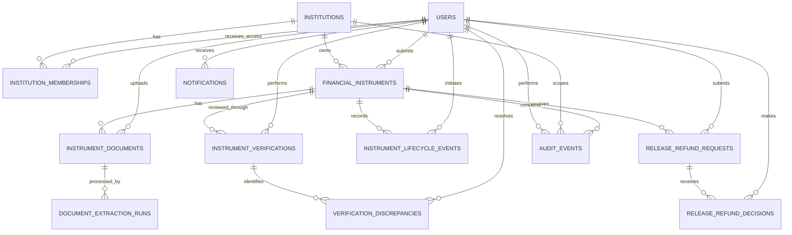

# DATABASE.md

# FDR-SMART — Database Design

## 1. Purpose

This document defines the database schema for FDR-SMART, a centralized portal for managing institution-wise and instrument-wise security deposits and Fixed Deposit Receipts (FDRs) for the AICTE Regulation Bureau.

The database supports the core lifecycle of a financial instrument:

1. Institution registration and authorized user access.
2. FDR submission and secure document storage.
3. Document processing and OCR-based field extraction.
4. Human verification, discrepancy tracking, and verification outcomes.
5. Maturity monitoring and renewal or replacement.
6. Release/refund request submission and review.
7. Notifications, reporting, administrative operations, and audit trails.

The design follows the modular-monolith architecture defined in `ARCHITECTURE.md`.

### Design principles

* Maintain one authoritative record for each financial instrument.
* Preserve submitted, extracted, corrected, and independently confirmed values with clear provenance.
* Separate automated extraction from human verification and official decisions.
* Enforce institution-level data isolation and role-based authorization.
* Preserve historical verification, replacement, release/refund, and audit records.
* Store uploaded documents outside the relational database in private object storage.
* Avoid duplicate status fields, unnecessary abstractions, and premature optimization.
* Do not use the database to imply that a financial transaction has occurred when the portal only records an administrative decision.

---

## 2. Database Technology

### 2.1 Primary database

**PostgreSQL** is the recommended relational database.

| Concern                       | Decision                | Rationale                                                                              |
| ----------------------------- | ----------------------- | -------------------------------------------------------------------------------------- |
| Relational database           | PostgreSQL              | Strong transactional guarantees, constraints, indexing, and relational integrity       |
| ORM                           | SQLAlchemy 2.x          | Consistent with the backend architecture                                               |
| Schema migrations             | Alembic                 | Version-controlled, repeatable schema evolution                                        |
| Primary key strategy          | UUID                    | Stable identifiers that are difficult to guess and suitable for distributed references |
| Monetary values               | `NUMERIC(18,2)`         | Exact decimal arithmetic without floating-point rounding                               |
| Date-only business fields     | `DATE`                  | Appropriate for issue dates, maturity dates, and other calendar dates                  |
| Event timestamps              | `TIMESTAMPTZ`           | Unambiguous timestamps stored and compared consistently                                |
| Structured extraction details | `JSONB` where justified | Supports variable OCR output without replacing relational fields                       |
| Document storage              | Private object storage  | Keeps binary files out of the relational database                                      |
| Database encoding             | UTF-8                   | Supports institution names and multilingual text where required                        |

### 2.2 Database conventions

1. Use UUID primary keys for application-managed entities.
2. Use `snake_case` for tables, columns, indexes, and constraints.
3. Use explicit foreign keys and meaningful constraint names.
4. Use `NOT NULL` for mandatory fields.
5. Use database constraints for invariants that must hold regardless of which API or background worker performs the operation.
6. Use application-level validation for contextual rules that depend on user permissions, workflow state, or external information.
7. Use UTC timestamps for persisted event times. Display dates and times in the approved business timezone.
8. Use soft deletion only where retention and business requirements permit it. Financial instruments, decisions, and audit history should not be silently deleted.
9. Use database transactions for related state changes.
10. Do not store secrets, authentication tokens, or complete uploaded documents in ordinary business tables.

### 2.3 Schema organization

The initial implementation should use a single PostgreSQL database with logically separated application modules.

The tables in this document can initially reside in the default application schema, `public`, or in an explicitly managed application schema if deployment standards require it.

Separate databases or schemas for individual modules are not required for the MVP.

---

## 3. Data Model Overview

The data model is organized around the following entities:

| Entity                        | Purpose                                                                         |
| ----------------------------- | ------------------------------------------------------------------------------- |
| `institutions`                | Stores registered institutions                                                  |
| `users`                       | Stores application user profiles linked to the approved authentication provider |
| `institution_memberships`     | Defines users' access to specific institutions                                  |
| `financial_instruments`       | Stores FDR and security deposit records                                         |
| `instrument_documents`        | Stores metadata and private-storage references for uploaded documents           |
| `document_extraction_runs`    | Tracks OCR or document extraction attempts                                      |
| `instrument_verifications`    | Records verification outcomes and reviewer decisions                            |
| `verification_discrepancies`  | Records identified differences and their resolution                             |
| `instrument_lifecycle_events` | Preserves significant instrument lifecycle changes                              |
| `release_refund_requests`     | Stores release/refund requests and their workflow state                         |
| `release_refund_decisions`    | Preserves decisions made on release/refund requests                             |
| `notifications`               | Stores user-facing notification records                                         |
| `audit_events`                | Records security-relevant and business-critical actions                         |

The schema deliberately avoids separate tables for every status, simple reference value, or dashboard metric. Enumerated states can be represented by constrained text values or PostgreSQL enums, subject to the migration strategy described later.

---

## 4. Entity Relationship Diagram

The following ER diagram describes the primary relationships. It omits some secondary relationships for readability; detailed foreign keys are specified in the table definitions.



### 4.1 Relationship summary

* One institution can have multiple authorized users through institution memberships.
* One institution can own multiple financial instrument records.
* One financial instrument can have multiple associated documents, extraction runs, verification records, lifecycle events, and release/refund requests.
* One verification record can identify multiple discrepancies.
* One release/refund request can receive multiple decision records if the approved workflow permits resubmission or reconsideration.
* A replacement instrument can reference its predecessor through a self-referencing foreign key.
* Notifications belong to their intended recipients.
* Audit events can reference an institution, instrument, user, or another relevant entity without requiring a separate audit table for each module.

---

# 5. Table Definitions

## 5.1 `institutions`

Stores the institution identity and administrative registration information.

| Column             | Type           | Constraints                | Description                             |
| ------------------ | -------------- | -------------------------- | --------------------------------------- |
| `id`               | `UUID`         | PK                         | Institution identifier                  |
| `institution_code` | `VARCHAR(50)`  | NOT NULL, UNIQUE           | Official or approved institution code   |
| `name`             | `VARCHAR(255)` | NOT NULL                   | Institution name                        |
| `institution_type` | `VARCHAR(100)` | NULL                       | Institution classification, if required |
| `address`          | `TEXT`         | NULL                       | Registered address                      |
| `contact_email`    | `VARCHAR(254)` | NULL                       | Official contact email                  |
| `contact_phone`    | `VARCHAR(30)`  | NULL                       | Official contact number                 |
| `status`           | `VARCHAR(20)`  | NOT NULL, DEFAULT `active` | Registration state                      |
| `created_at`       | `TIMESTAMPTZ`  | NOT NULL                   | Creation timestamp                      |
| `updated_at`       | `TIMESTAMPTZ`  | NOT NULL                   | Last update timestamp                   |

### Constraints

* `institution_code` must be unique after applying the approved normalization policy.
* `status` must be one of the permitted institution states, initially `active`, `suspended`, or `inactive`.
* Institution records referenced by financial instruments must not be physically deleted.
* Suspending an institution must prevent new actions as defined by the authorization policy without destroying its historical records.

### Notes

Institution identifiers should be established through an approved source or controlled administrative registration process. Do not assume that a user-supplied institution name alone establishes institutional identity.

---

## 5.2 `users`

Stores application-level user profiles. Authentication credentials remain with the approved identity provider unless the project explicitly adopts a different authentication architecture.

| Column          | Type           | Constraints                | Description                                       |
| --------------- | -------------- | -------------------------- | ------------------------------------------------- |
| `id`            | `UUID`         | PK                         | Application user identifier                       |
| `auth_provider` | `VARCHAR(50)`  | NOT NULL                   | Authentication provider identifier                |
| `auth_subject`  | `VARCHAR(255)` | NOT NULL                   | Stable subject identifier from the provider       |
| `email`         | `VARCHAR(254)` | NOT NULL                   | User email address                                |
| `display_name`  | `VARCHAR(255)` | NOT NULL                   | User's display name                               |
| `status`        | `VARCHAR(20)`  | NOT NULL, DEFAULT `active` | Application access status                         |
| `last_login_at` | `TIMESTAMPTZ`  | NULL                       | Last successful login recorded by the application |
| `created_at`    | `TIMESTAMPTZ`  | NOT NULL                   | Creation timestamp                                |
| `updated_at`    | `TIMESTAMPTZ`  | NOT NULL                   | Last update timestamp                             |

### Constraints

* The combination of `auth_provider` and `auth_subject` must be unique.
* Email uniqueness must follow the approved identity-management policy. If the application requires one profile per normalized email, enforce that policy explicitly.
* `status` must be a permitted value, initially `active`, `suspended`, or `inactive`.
* A disabled application user must not gain access merely because the identity provider still authenticates them.
* Do not store passwords, refresh tokens, access tokens, or identity-provider secrets in this table.

### Notes

A user profile does not itself grant access to an institution or administrative function. Access is determined by application roles, institutional membership, and backend authorization rules.

---

## 5.3 `institution_memberships`

Associates users with institutions they are authorized to represent or administer.

This table is necessary to enforce institution-level data isolation when multiple institutions use the same application.

| Column           | Type          | Constraints                      | Description           |
| ---------------- | ------------- | -------------------------------- | --------------------- |
| `id`             | `UUID`        | PK                               | Membership identifier |
| `institution_id` | `UUID`        | FK → `institutions.id`, NOT NULL | Institution           |
| `user_id`        | `UUID`        | FK → `users.id`, NOT NULL        | User                  |
| `role`           | `VARCHAR(40)` | NOT NULL                         | Institutional role    |
| `status`         | `VARCHAR(20)` | NOT NULL, DEFAULT `active`       | Membership state      |
| `created_at`     | `TIMESTAMPTZ` | NOT NULL                         | Creation timestamp    |
| `updated_at`     | `TIMESTAMPTZ` | NOT NULL                         | Last update timestamp |

### Suggested institutional roles

* `institution_representative`
* `institution_admin`, if approved as a distinct role

System-wide roles such as scrutiny officer, approving authority, and system administrator should be managed separately from institutional membership. They must not be represented as institutional roles merely to simplify access checks.

### Constraints

* A user must not have duplicate active memberships for the same institution and role.
* If the application allows only one institutional role per user per institution, enforce uniqueness on `(institution_id, user_id)` instead.
* Membership status must be constrained to the approved states.
* Only authorized administrators may create, modify, suspend, or reactivate memberships.

### Notes

The uniqueness rule must match the actual role model. Do not allow multiple memberships per institution and user unless the application genuinely supports that arrangement.

---

## 5.4 `financial_instruments`

The central table for FDRs and other approved security deposit instruments.

One row represents one specific financial instrument, not an institution's entire deposit obligation.

| Column                      | Type            | Constraints                           | Description                                           |
| --------------------------- | --------------- | ------------------------------------- | ----------------------------------------------------- |
| `id`                        | `UUID`          | PK                                    | Internal instrument identifier                        |
| `institution_id`            | `UUID`          | FK → `institutions.id`, NOT NULL      | Owning institution                                    |
| `reference_number`          | `VARCHAR(100)`  | NOT NULL                              | Instrument reference number as submitted              |
| `instrument_type`           | `VARCHAR(30)`   | NOT NULL                              | Type of financial instrument                          |
| `bank_name`                 | `VARCHAR(255)`  | NOT NULL                              | Issuing bank                                          |
| `branch_name`               | `VARCHAR(255)`  | NULL                                  | Issuing branch                                        |
| `amount`                    | `NUMERIC(18,2)` | NOT NULL                              | Instrument amount                                     |
| `currency`                  | `CHAR(3)`       | NOT NULL                              | ISO-style currency code, initially expected to be INR |
| `issue_date`                | `DATE`          | NULL                                  | Instrument issue date                                 |
| `maturity_date`             | `DATE`          | NULL                                  | Contractual maturity date                             |
| `submission_status`         | `VARCHAR(30)`   | NOT NULL                              | Submission workflow state                             |
| `verification_status`       | `VARCHAR(30)`   | NOT NULL                              | Verification workflow state                           |
| `lifecycle_status`          | `VARCHAR(30)`   | NOT NULL                              | Current instrument lifecycle state                    |
| `predecessor_instrument_id` | `UUID`          | FK → `financial_instruments.id`, NULL | Previous instrument replaced by this instrument       |
| `submitted_by_user_id`      | `UUID`          | FK → `users.id`, NOT NULL             | User who submitted the record                         |
| `submitted_at`              | `TIMESTAMPTZ`   | NULL                                  | Initial submission time                               |
| `created_at`                | `TIMESTAMPTZ`   | NOT NULL                              | Record creation timestamp                             |
| `updated_at`                | `TIMESTAMPTZ`   | NOT NULL                              | Last update timestamp                                 |

### Suggested instrument types

The permitted values must reflect the actual regulatory process. An initial set may include:

* `fdr`
* `other_security_deposit`, only if the PRD explicitly includes this category

Do not introduce additional instrument types without confirming that they are in scope.

### Suggested submission states

* `draft`
* `submitted`
* `returned_for_correction`
* `resubmitted`
* `withdrawn`, only where policy permits

### Suggested verification states

* `not_started`
* `pending`
* `in_review`
* `verified`
* `discrepancy_found`
* `rejected`, only if the official workflow defines rejection as distinct from returning a submission for correction

### Suggested lifecycle states

* `active`
* `matured`
* `renewal_pending`
* `replacement_pending`
* `released`
* `closed`

The final allowed values and transitions must be approved against the actual business process.

### Constraints and validation

* `amount` must be greater than zero.
* `currency` must be a supported currency code. If the application is limited to INR, enforce that limitation.
* `maturity_date` must not precede `issue_date` when both are present.
* A predecessor instrument must belong to the same institution as its replacement.
* An instrument must not reference itself as its predecessor.
* Replacement operations must be validated transactionally to prevent circular replacement chains.
* `submitted_at` must be populated when a record first transitions into a submitted state.
* The backend must validate allowed state transitions; a valid enum value alone does not make a transition valid.
* Reference-number uniqueness must be based on an approved business rule. A bank may issue identical reference numbers across different branches or instrument types, so global uniqueness must not be assumed.

### Important data-provenance rule

The table represents the current application record. It must not be used to silently overwrite the original submitted values with OCR results or reviewer corrections.

Where submitted, extracted, corrected, and independently confirmed values differ, their provenance must be retained in the relevant document extraction, verification, discrepancy, and audit records.

### Replacement handling

A replacement is a new financial instrument with its own `id`. The new instrument references the previous instrument using `predecessor_instrument_id`.

The predecessor record must be retained. Replacing an instrument must not delete or rewrite the old instrument's historical data.

---

## 5.5 `instrument_documents`

Stores metadata and storage references for documents associated with an instrument. Binary document contents reside in private object storage.

| Column                | Type           | Constraints                               | Description                               |
| --------------------- | -------------- | ----------------------------------------- | ----------------------------------------- |
| `id`                  | `UUID`         | PK                                        | Document identifier                       |
| `instrument_id`       | `UUID`         | FK → `financial_instruments.id`, NOT NULL | Associated instrument                     |
| `uploaded_by_user_id` | `UUID`         | FK → `users.id`, NOT NULL                 | Uploading user                            |
| `document_type`       | `VARCHAR(40)`  | NOT NULL                                  | Document classification                   |
| `original_filename`   | `VARCHAR(255)` | NOT NULL                                  | Display filename supplied with the upload |
| `storage_key`         | `VARCHAR(512)` | NOT NULL, UNIQUE                          | Private object-storage key                |
| `mime_type`           | `VARCHAR(100)` | NOT NULL                                  | Validated media type                      |
| `file_size_bytes`     | `BIGINT`       | NOT NULL                                  | File size                                 |
| `sha256_checksum`     | `CHAR(64)`     | NOT NULL                                  | SHA-256 checksum of stored content        |
| `scan_status`         | `VARCHAR(20)`  | NOT NULL                                  | Malware/security scanning state           |
| `document_status`     | `VARCHAR(20)`  | NOT NULL                                  | Application-level document state          |
| `uploaded_at`         | `TIMESTAMPTZ`  | NOT NULL                                  | Upload timestamp                          |
| `created_at`          | `TIMESTAMPTZ`  | NOT NULL                                  | Record creation timestamp                 |

### Suggested document types

* `fdr_copy`
* `renewal_copy`
* `replacement_copy`
* `supporting_document`
* `release_supporting_document`

The exact permitted types should follow the PRD and approved submission requirements.

### Suggested scan states

* `pending`
* `clean`
* `rejected`
* `failed`, for cases requiring retry or manual intervention

### Suggested document states

* `active`
* `superseded`
* `quarantined`
* `deleted`, only where the retention policy permits logical deletion

### Constraints and validation

* `file_size_bytes` must be greater than zero.
* Upload size limits and allowed file types must be configured according to the approved security policy.
* `storage_key` must be generated by the application or trusted storage integration. It must not be derived directly from an untrusted filename.
* The checksum must be calculated from the file content.
* A document that has not passed required security scanning must not be made available for ordinary viewing or processing.
* Document downloads must be authorized through the backend.
* The application must not expose permanent public storage URLs.

### Notes

Document metadata must not contain the entire file, public access credentials, or reusable signed URLs. Temporary download URLs, if used, should be generated only after authorization and should expire promptly.

---

## 5.6 `document_extraction_runs`

Tracks OCR and other automated document extraction attempts.

A document can have multiple extraction runs if processing is retried or the extraction pipeline changes.

| Column              | Type           | Constraints                              | Description                                                          |
| ------------------- | -------------- | ---------------------------------------- | -------------------------------------------------------------------- |
| `id`                | `UUID`         | PK                                       | Extraction-run identifier                                            |
| `document_id`       | `UUID`         | FK → `instrument_documents.id`, NOT NULL | Source document                                                      |
| `status`            | `VARCHAR(20)`  | NOT NULL                                 | Processing state                                                     |
| `processor_name`    | `VARCHAR(100)` | NOT NULL                                 | OCR/extraction engine                                                |
| `processor_version` | `VARCHAR(100)` | NULL                                     | Engine or pipeline version                                           |
| `extracted_fields`  | `JSONB`        | NULL                                     | Extracted values, confidence information, and field-level provenance |
| `error_code`        | `VARCHAR(100)` | NULL                                     | Sanitized processing error identifier                                |
| `started_at`        | `TIMESTAMPTZ`  | NULL                                     | Processing start time                                                |
| `completed_at`      | `TIMESTAMPTZ`  | NULL                                     | Processing completion time                                           |
| `created_at`        | `TIMESTAMPTZ`  | NOT NULL                                 | Record creation timestamp                                            |

### Suggested processing states

* `queued`
* `processing`
* `completed`
* `failed`
* `cancelled`

### Extraction data

The `extracted_fields` document may contain values such as:

* Reference number
* Bank name
* Branch name
* Amount
* Issue date
* Maturity date
* Currency, when identifiable
* Confidence scores
* Page or location references
* Field-level extraction warnings

A representative logical structure is:

```json
{
  "reference_number": {
    "value": "EXAMPLE-123",
    "confidence": 0.94,
    "page": 1
  },
  "amount": {
    "value": "500000.00",
    "confidence": 0.91,
    "page": 1
  }
}
```

This example illustrates the data shape only; it is not an instruction to store every field in JSON instead of using relational columns.

### Constraints and validation

* A completed run must have a completion timestamp.
* A processing run must refer to an existing document.
* Failed processing attempts must preserve a sanitized error code and appropriate diagnostic information without leaking secrets.
* Extraction results are machine-generated observations, not authoritative verification outcomes.
* Confidence scores must not be treated as proof that a document or financial instrument is genuine.
* OCR retries must create or update runs according to a consistent idempotency policy so duplicate jobs do not create misleading results.

### Notes

Do not duplicate all extracted values into additional columns in `financial_instruments` merely to simplify the UI. The application should map extraction results to the instrument's business fields through an explicit review and correction process.

---

## 5.7 `instrument_verifications`

Records human review and verification outcomes.

Each row represents a verification action or review outcome, not a permanent boolean property of the instrument.

| Column                | Type          | Constraints                               | Description                    |
| --------------------- | ------------- | ----------------------------------------- | ------------------------------ |
| `id`                  | `UUID`        | PK                                        | Verification record identifier |
| `instrument_id`       | `UUID`        | FK → `financial_instruments.id`, NOT NULL | Instrument being reviewed      |
| `reviewed_by_user_id` | `UUID`        | FK → `users.id`, NOT NULL                 | Reviewer                       |
| `outcome`             | `VARCHAR(30)` | NOT NULL                                  | Recorded verification outcome  |
| `review_notes`        | `TEXT`        | NULL                                      | Review explanation or comments |
| `reviewed_at`         | `TIMESTAMPTZ` | NOT NULL                                  | Review timestamp               |
| `created_at`          | `TIMESTAMPTZ` | NOT NULL                                  | Record creation timestamp      |

### Suggested outcomes

* `verified`
* `discrepancy_found`
* `returned_for_correction`
* `rejected`, only if supported by the approved workflow

### Constraints and validation

* Only users authorized for the verification stage may create verification records.
* A reviewer must not be able to verify an instrument merely because they can view it.
* Verification must validate the current workflow state and required evidence.
* Historical verification records must not be overwritten when a later review occurs.
* If separation of duties is required, the backend must prevent the same person from performing incompatible submission, verification, or approval actions.
* The current verification status on `financial_instruments` must remain consistent with the latest applicable workflow transition.

### Notes

A verification record captures the reviewer and outcome. It must not be interpreted as proof of independent bank confirmation unless the verification process actually used an approved, independent confirmation source.

If the business requires external bank verification, the evidence and source of that confirmation must be explicitly recorded rather than inferred from the fact that a human reviewer selected `verified`.

---

## 5.8 `verification_discrepancies`

Records differences discovered during review between submitted data, extracted values, corrected values, or independently confirmed information.

| Column                | Type           | Constraints                                  | Description                                     |
| --------------------- | -------------- | -------------------------------------------- | ----------------------------------------------- |
| `id`                  | `UUID`         | PK                                           | Discrepancy identifier                          |
| `verification_id`     | `UUID`         | FK → `instrument_verifications.id`, NOT NULL | Associated verification review                  |
| `field_name`          | `VARCHAR(100)` | NOT NULL                                     | Field where the discrepancy was found           |
| `source_type`         | `VARCHAR(30)`  | NOT NULL                                     | Source of the compared value                    |
| `expected_value`      | `TEXT`         | NULL                                         | Expected or authoritative value, when available |
| `observed_value`      | `TEXT`         | NULL                                         | Observed value                                  |
| `resolution_status`   | `VARCHAR(20)`  | NOT NULL                                     | Discrepancy resolution state                    |
| `resolution_notes`    | `TEXT`         | NULL                                         | Explanation of resolution                       |
| `resolved_by_user_id` | `UUID`         | FK → `users.id`, NULL                        | User resolving the discrepancy                  |
| `resolved_at`         | `TIMESTAMPTZ`  | NULL                                         | Resolution timestamp                            |
| `created_at`          | `TIMESTAMPTZ`  | NOT NULL                                     | Creation timestamp                              |

### Suggested source types

* `submitted`
* `extracted`
* `reviewer_corrected`
* `external_confirmation`

### Suggested resolution states

* `open`
* `resolved`
* `accepted_with_explanation`
* `not_applicable`

The permitted states must reflect the approved review policy.

### Constraints and validation

* `field_name` must refer to a recognized business field or an explicitly permitted extension.
* `source_type` must be constrained to approved source categories.
* Resolved discrepancies must have a resolution timestamp.
* Where resolution requires a reviewer, `resolved_by_user_id` must be populated.
* Values must not be silently changed to make a discrepancy disappear.
* A discrepancy involving sensitive values must be protected from unauthorized access and excessive logging.

### Notes

The values are stored as text because discrepancies may compare different representations, including dates, amounts, extracted strings, and externally reported values. The application must perform appropriate typed comparison and normalization before declaring a mismatch.

For a small MVP, field-level provenance may be stored in extraction and discrepancy records. A generalized field-history engine is not necessary unless the approved requirements demand a comprehensive revision history for every business field.

---

## 5.9 `instrument_lifecycle_events`

Preserves significant lifecycle events such as renewal, replacement initiation, maturity handling, release, or closure.

This table complements `audit_events`: lifecycle events are business-facing history, while audit events record security-relevant and operational actions.

| Column                  | Type          | Constraints                               | Description                                 |
| ----------------------- | ------------- | ----------------------------------------- | ------------------------------------------- |
| `id`                    | `UUID`        | PK                                        | Lifecycle event identifier                  |
| `instrument_id`         | `UUID`        | FK → `financial_instruments.id`, NOT NULL | Instrument concerned                        |
| `event_type`            | `VARCHAR(40)` | NOT NULL                                  | Lifecycle event category                    |
| `previous_status`       | `VARCHAR(30)` | NULL                                      | Previous lifecycle state                    |
| `new_status`            | `VARCHAR(30)` | NULL                                      | New lifecycle state                         |
| `related_instrument_id` | `UUID`        | FK → `financial_instruments.id`, NULL     | Related replacement or successor instrument |
| `initiated_by_user_id`  | `UUID`        | FK → `users.id`, NULL                     | Initiating user, when applicable            |
| `event_notes`           | `TEXT`        | NULL                                      | Business explanation                        |
| `occurred_at`           | `TIMESTAMPTZ` | NOT NULL                                  | Business event time                         |
| `created_at`            | `TIMESTAMPTZ` | NOT NULL                                  | Database record creation time               |

### Suggested event types

* `submitted`
* `verified`
* `maturity_detected`
* `renewal_initiated`
* `replacement_initiated`
* `replacement_completed`
* `release_requested`
* `released`
* `closed`

Only events required by the approved lifecycle should be enabled.

### Constraints and validation

* `previous_status` and `new_status` must contain valid states when populated.
* Related instruments must be institutionally consistent where the event links replacement instruments.
* Events representing a state transition must be recorded in the same database transaction as the corresponding state change.
* Scheduled maturity detection must be idempotent so repeated scheduler executions do not create duplicate business events.
* Historical lifecycle events must not be silently modified or deleted.

### Notes

This table is not intended to become a general-purpose event-sourcing system. It records selected business milestones for traceability and user-facing history.

---

## 5.10 `release_refund_requests`

Stores requests to release or refund a security deposit or FDR, including their review state.

This table records the administrative workflow. It does not execute a bank transfer or prove that funds have been returned.

| Column                 | Type          | Constraints                               | Description                    |
| ---------------------- | ------------- | ----------------------------------------- | ------------------------------ |
| `id`                   | `UUID`        | PK                                        | Request identifier             |
| `instrument_id`        | `UUID`        | FK → `financial_instruments.id`, NOT NULL | Related instrument             |
| `requested_by_user_id` | `UUID`        | FK → `users.id`, NOT NULL                 | Requesting user                |
| `request_type`         | `VARCHAR(20)` | NOT NULL                                  | Release or refund request type |
| `status`               | `VARCHAR(30)` | NOT NULL                                  | Current request state          |
| `reason`               | `TEXT`        | NOT NULL                                  | Request justification          |
| `submitted_at`         | `TIMESTAMPTZ` | NULL                                      | Submission timestamp           |
| `created_at`           | `TIMESTAMPTZ` | NOT NULL                                  | Creation timestamp             |
| `updated_at`           | `TIMESTAMPTZ` | NOT NULL                                  | Last update timestamp          |

### Suggested request types

* `release`
* `refund`

Use only the categories explicitly defined by the business process.

### Suggested request states

* `draft`
* `submitted`
* `under_review`
* `returned_for_correction`
* `approved`
* `rejected`
* `cancelled`
* `completed`, only if the portal has an authorized way to record completion

### Constraints and validation

* A request must reference an instrument belonging to the requesting user's authorized institution.
* Only authorized users may submit, review, approve, reject, or cancel a request.
* Request state transitions must be validated in the backend.
* An instrument must meet the policy requirements for the requested action.
* An approved request must not automatically change the instrument to `released` unless the approved business workflow explicitly defines approval as the release event.
* The system must distinguish administrative approval from actual fund release or refund completion.
* Duplicate active requests for the same instrument and request type should be prevented where the business rules prohibit them.

### Notes

If completion requires evidence, such as an official confirmation document or transaction reference, store that evidence through `instrument_documents` or a dedicated field only after confirming the requirement. Do not add speculative banking transaction fields to the MVP schema.

---

## 5.11 `release_refund_decisions`

Preserves individual decisions made during the release/refund workflow.

Separating decisions from the current request state allows the system to retain decision history without overwriting previous decisions.

| Column               | Type          | Constraints                                 | Description               |
| -------------------- | ------------- | ------------------------------------------- | ------------------------- |
| `id`                 | `UUID`        | PK                                          | Decision identifier       |
| `request_id`         | `UUID`        | FK → `release_refund_requests.id`, NOT NULL | Related request           |
| `decided_by_user_id` | `UUID`        | FK → `users.id`, NOT NULL                   | Decision-maker            |
| `decision`           | `VARCHAR(30)` | NOT NULL                                    | Decision outcome          |
| `comments`           | `TEXT`        | NULL                                        | Decision explanation      |
| `decided_at`         | `TIMESTAMPTZ` | NOT NULL                                    | Decision timestamp        |
| `created_at`         | `TIMESTAMPTZ` | NOT NULL                                    | Record creation timestamp |

### Suggested decisions

* `approved`
* `rejected`
* `returned_for_correction`

### Constraints and validation

* Only authorized decision-makers may create decisions.
* Decisions must be consistent with the current request state.
* If the workflow permits only one final decision, enforce that rule through transactional application logic and an appropriate database constraint where feasible.
* If reconsideration or resubmission is permitted, preserve previous decisions and define which decision is currently effective.
* A decision record must not be modified to conceal a previous outcome.

### Notes

This table does not replace `audit_events`. The decision table captures the business decision; the audit table captures who performed the action and other security-relevant context.

---

## 5.12 `notifications`

Stores user-facing notification records for workflow updates, discrepancies, maturity reminders, renewal events, and release/refund changes.

| Column              | Type           | Constraints                             | Description                                      |
| ------------------- | -------------- | --------------------------------------- | ------------------------------------------------ |
| `id`                | `UUID`         | PK                                      | Notification identifier                          |
| `recipient_user_id` | `UUID`         | FK → `users.id`, NOT NULL               | Intended recipient                               |
| `institution_id`    | `UUID`         | FK → `institutions.id`, NULL            | Relevant institution, where applicable           |
| `instrument_id`     | `UUID`         | FK → `financial_instruments.id`, NULL   | Related instrument, where applicable             |
| `request_id`        | `UUID`         | FK → `release_refund_requests.id`, NULL | Related release/refund request, where applicable |
| `notification_type` | `VARCHAR(50)`  | NOT NULL                                | Notification category                            |
| `title`             | `VARCHAR(200)` | NOT NULL                                | Display title                                    |
| `message`           | `TEXT`         | NOT NULL                                | User-facing message                              |
| `read_at`           | `TIMESTAMPTZ`  | NULL                                    | Time the notification was read                   |
| `created_at`        | `TIMESTAMPTZ`  | NOT NULL                                | Creation timestamp                               |

### Suggested notification categories

* `submission_update`
* `verification_update`
* `discrepancy_update`
* `maturity_reminder`
* `renewal_update`
* `release_refund_update`
* `administrative_notice`

The final set should follow the approved notification requirements.

### Constraints and validation

* A notification must have an active or otherwise eligible recipient according to policy.
* Notifications must not expose information that the recipient is not authorized to access.
* Notifications generated by scheduled jobs must be deduplicated for the relevant event and recipient.
* Read status is represented by `read_at`; a separate boolean `is_read` is unnecessary.
* Notification messages must not include authentication secrets or unnecessary sensitive financial details.

### Notes

Email delivery, if required, should be handled through the approved notification infrastructure. The notification record represents the in-application message, not proof of email delivery.

If durable delivery tracking becomes a confirmed requirement, delivery attempts and provider responses can be introduced later rather than adding speculative fields now.

---

## 5.13 `audit_events`

Stores security-relevant and business-critical actions for traceability.

Audit records should be append-only for normal application operations. Corrections must be represented by additional events rather than rewriting historical records.

| Column           | Type           | Constraints                           | Description                                  |
| ---------------- | -------------- | ------------------------------------- | -------------------------------------------- |
| `id`             | `UUID`         | PK                                    | Audit event identifier                       |
| `actor_user_id`  | `UUID`         | FK → `users.id`, NULL                 | User who performed the action, if applicable |
| `institution_id` | `UUID`         | FK → `institutions.id`, NULL          | Relevant institution, if applicable          |
| `instrument_id`  | `UUID`         | FK → `financial_instruments.id`, NULL | Relevant instrument, if applicable           |
| `action`         | `VARCHAR(100)` | NOT NULL                              | Action identifier                            |
| `entity_type`    | `VARCHAR(80)`  | NOT NULL                              | Entity affected                              |
| `entity_id`      | `UUID`         | NULL                                  | Identifier of the affected entity            |
| `outcome`        | `VARCHAR(20)`  | NOT NULL                              | Action result                                |
| `correlation_id` | `VARCHAR(100)` | NULL                                  | Request or workflow correlation identifier   |
| `details`        | `JSONB`        | NULL                                  | Minimal structured audit context             |
| `occurred_at`    | `TIMESTAMPTZ`  | NOT NULL                              | Event occurrence timestamp                   |

### Actions to audit

At minimum, record:

* Authentication-related application events where appropriate.
* User, role, and membership changes.
* Institution registration and status changes.
* Instrument creation, submission, correction, and state transitions.
* Document uploads, access-sensitive document operations, and document removal or quarantine.
* OCR processing outcomes where relevant to the business record.
* Verification outcomes and discrepancy resolution.
* Renewal and replacement operations.
* Release/refund submissions, decisions, and state changes.
* Administrative configuration changes.
* Authorization failures and other security-relevant events where the security policy requires them.

### Constraints and validation

* Audit records must be created by trusted backend code, not accepted as authoritative client-supplied records.
* The ordinary application role must not have permission to update or delete audit records.
* Audit details must not contain passwords, tokens, private keys, complete uploaded documents, or unnecessary personal information.
* `outcome` must use an approved set of values, such as `success`, `failure`, or `denied`.
* Audit events must not be treated as a replacement for workflow-specific business records.
* Database administrators and infrastructure operators may have technical capabilities beyond application permissions; production controls must address this separately.

### Notes

Because the audit table references multiple entity types, `entity_id` is a polymorphic reference and cannot have a conventional foreign key to every possible entity table.

Where a specific entity relationship is required for integrity or querying, use the explicit nullable foreign keys provided for institutions and instruments. Do not add a separate audit foreign key for every possible table without a demonstrated need.

For high-assurance audit requirements, consider forwarding security-critical events to a separately controlled append-only logging destination.

---

# 6. Keys and Referential Integrity

## 6.1 Primary keys

Every main entity uses a UUID primary key.

Primary keys must be generated by the application or database using a consistent UUID strategy. They must not depend on user-provided institution codes, FDR numbers, email addresses, or filenames.

## 6.2 Foreign-key deletion policies

Foreign-key deletion behavior must preserve historical records.

| Relationship                        | Recommended behavior                                                |
| ----------------------------------- | ------------------------------------------------------------------- |
| Institution → membership            | Prevent physical institution deletion while referenced              |
| User → membership                   | Prevent deletion while historical records require the user identity |
| Institution → instrument            | Prevent physical institution deletion while instruments exist       |
| Instrument → document               | Prevent physical deletion of an instrument while documents exist    |
| Document → extraction run           | Prevent deletion while processing history is retained               |
| Instrument → verification           | Prevent deletion while verification history is retained             |
| Verification → discrepancy          | Prevent deletion while discrepancy history is retained              |
| Instrument → lifecycle event        | Prevent deletion while lifecycle history is retained                |
| Instrument → release/refund request | Prevent deletion while requests exist                               |
| Request → decision                  | Prevent deletion while decision history is retained                 |
| User → audit event                  | Preserve audit history even when a user is deactivated              |

Use `ON DELETE RESTRICT` or the equivalent default behavior for retained business records. Use `SET NULL` only where it is explicitly appropriate, such as preserving an audit event after a user profile is legally removed and the applicable retention policy permits anonymization.

Do not use cascading deletion for core financial, verification, decision, or audit history.

## 6.3 Referential integrity beyond foreign keys

Foreign keys alone cannot enforce all business relationships.

The backend must validate:

* The replacement instrument and its predecessor belong to the same institution.
* A document's uploader is authorized to submit a document for the instrument's institution.
* A release/refund requester is authorized for the associated instrument.
* A reviewer is authorized for the verification stage.
* A decision-maker is authorized for the request's decision stage.
* Lifecycle transitions are valid for the instrument's current state.
* A request, decision, verification, and audit event are associated with the correct workflow operation.

Where a rule can be represented safely as a database constraint, use the constraint in addition to application validation.

---

# 7. Constraints and Validation Strategy

Validation is divided between database-level invariants and application-level business rules.

## 7.1 Database-level validation

The database must enforce:

* Required values through `NOT NULL`.
* Entity identity through primary keys.
* Uniqueness for institution codes and authentication-provider subjects.
* Referential integrity through foreign keys.
* Positive financial amounts.
* Valid date ordering when both dates are known.
* Valid status values through `CHECK` constraints or PostgreSQL enums.
* Valid file sizes.
* Valid timestamps and required completion timestamps where appropriate.
* Unique storage keys.
* Other deterministic invariants that can be expressed without access to user permissions or external services.

## 7.2 Application-level validation

The backend must enforce:

* Authentication and role authorization.
* Institution-level access.
* Allowed workflow transitions.
* Separation of duties.
* Rules for submitting, correcting, verifying, replacing, or releasing instruments.
* Document format and content validation.
* OCR result interpretation and field normalization.
* Independent verification requirements.
* Duplicate active request prevention where required.
* External bank verification, only when an authorized verification mechanism exists.
* Notification deduplication.
* Retention and deletion policies.
* Approved maturity reminder schedules and business timezone behavior.

## 7.3 State consistency

The following fields have different meanings and must not be merged:

| Field                              | Meaning                                                       |
| ---------------------------------- | ------------------------------------------------------------- |
| `submission_status`                | State of the institution's submission                         |
| `verification_status`              | State of scrutiny or verification                             |
| `lifecycle_status`                 | State of the financial instrument over its business lifecycle |
| `release_refund_requests.status`   | State of a specific release/refund request                    |
| `document_extraction_runs.status`  | State of an automated processing attempt                      |
| `instrument_documents.scan_status` | State of the document security scan                           |

A matured instrument is not automatically noncompliant. An OCR result is not a verification decision. An approved release/refund request is not necessarily proof of a completed financial transaction.

## 7.4 Concurrent updates

Operations that change workflow state must use transactions and concurrency control.

For example, when a reviewer verifies an instrument:

1. Load the current instrument state.
2. Confirm that the user has the required permission.
3. Confirm that the current state permits verification.
4. Record the verification result.
5. Update the instrument's current verification state.
6. Create relevant discrepancy, lifecycle, and audit records.
7. Commit all changes together.

Use row-level locking or optimistic concurrency control where simultaneous updates could cause conflicting decisions. The selected approach should be consistent across workflow transitions.

---

# 8. Indexes Based on Real Queries

Indexes should support the portal's expected query patterns rather than being created indiscriminately.

The following indexes are recommended for the MVP.

## 8.1 Institution lookup

| Index        | Columns                          | Purpose                                          |
| ------------ | -------------------------------- | ------------------------------------------------ |
| Unique index | `institutions(institution_code)` | Find institutions by official code               |
| Index        | `institutions(status, name)`     | Administrative institution listing and filtering |

A case-insensitive or normalized name index should be added only if the application supports name-based lookup and its normalization policy is defined.

## 8.2 User and membership lookup

| Index                     | Columns                                                 | Purpose                                           |
| ------------------------- | ------------------------------------------------------- | ------------------------------------------------- |
| Unique index              | `users(auth_provider, auth_subject)`                    | Resolve authenticated identity                    |
| Index                     | `users(status)`                                         | Administrative user filtering, if used frequently |
| Unique or composite index | `institution_memberships(institution_id, user_id)`      | Resolve institutional access                      |
| Index                     | `institution_memberships(user_id, status)`              | List institutions available to a user             |
| Index                     | `institution_memberships(institution_id, status, role)` | Resolve active institutional representatives      |

The exact membership uniqueness constraint must match whether multiple roles per institution-user pair are supported.

## 8.3 Financial instruments

| Index | Columns                                                                     | Purpose                                      |
| ----- | --------------------------------------------------------------------------- | -------------------------------------------- |
| Index | `financial_instruments(institution_id, created_at DESC)`                    | Institution instrument list                  |
| Index | `financial_instruments(institution_id, submission_status, created_at DESC)` | Institution submission workflow filtering    |
| Index | `financial_instruments(verification_status, created_at)`                    | Verification queue                           |
| Index | `financial_instruments(lifecycle_status, maturity_date)`                    | Maturity and lifecycle monitoring            |
| Index | `financial_instruments(maturity_date)`                                      | Date-based maturity queries, where required  |
| Index | `financial_instruments(predecessor_instrument_id)`                          | Replacement-chain lookup                     |
| Index | `financial_instruments(submitted_by_user_id, created_at DESC)`              | User's submitted records, if used frequently |

If the production workload demonstrates frequent lookup by reference number, add a composite index on institution and normalized reference number according to the approved matching policy.

Do not assume a reference number is globally unique without validating that rule against issuing-bank practices.

### Maturity query

The principal maturity query should select eligible instruments whose maturity dates fall within the configured reminder window and whose lifecycle state permits reminders.

The application should use the instrument's lifecycle and workflow rules to determine eligibility. The maturity date alone must not determine noncompliance or automatically initiate a release/refund decision.

## 8.4 Documents and extraction

| Index        | Columns                                                       | Purpose                                    |
| ------------ | ------------------------------------------------------------- | ------------------------------------------ |
| Unique index | `instrument_documents(storage_key)`                           | Prevent storage-key collisions             |
| Index        | `instrument_documents(instrument_id, uploaded_at DESC)`       | List documents for an instrument           |
| Index        | `instrument_documents(uploaded_by_user_id, uploaded_at DESC)` | Review recent uploads by user, if required |
| Index        | `document_extraction_runs(document_id, created_at DESC)`      | Retrieve extraction history                |
| Index        | `document_extraction_runs(status, created_at)`                | Find queued or failed extraction jobs      |

The unique storage-key constraint is required for correctness even if the database also creates an index to support it.

## 8.5 Verification and discrepancies

| Index | Columns                                                             | Purpose                             |
| ----- | ------------------------------------------------------------------- | ----------------------------------- |
| Index | `instrument_verifications(instrument_id, reviewed_at DESC)`         | Verification history                |
| Index | `instrument_verifications(reviewed_by_user_id, reviewed_at DESC)`   | Reviewer activity and audit support |
| Index | `verification_discrepancies(verification_id, resolution_status)`    | Discrepancies for a review          |
| Index | `verification_discrepancies(resolution_status, created_at)`         | Outstanding discrepancy queue       |
| Index | `verification_discrepancies(resolved_by_user_id, resolved_at DESC)` | Resolution history, if needed       |

## 8.6 Lifecycle events and requests

| Index | Columns                                                          | Purpose                                |
| ----- | ---------------------------------------------------------------- | -------------------------------------- |
| Index | `instrument_lifecycle_events(instrument_id, occurred_at DESC)`   | Instrument timeline                    |
| Index | `instrument_lifecycle_events(event_type, occurred_at)`           | Operational lifecycle reporting        |
| Index | `release_refund_requests(instrument_id, created_at DESC)`        | Requests associated with an instrument |
| Index | `release_refund_requests(status, submitted_at)`                  | Pending review queue                   |
| Index | `release_refund_requests(requested_by_user_id, created_at DESC)` | Requester's request list               |
| Index | `release_refund_decisions(request_id, decided_at DESC)`          | Decision history                       |
| Index | `release_refund_decisions(decided_by_user_id, decided_at DESC)`  | Decision-maker history                 |

If policy prohibits more than one active release/refund request of the same type per instrument, enforce this with a partial unique index over the active request states. The precise states must be confirmed before defining that index.

## 8.7 Notifications and audit events

| Index         | Columns                                                                     | Purpose                                           |
| ------------- | --------------------------------------------------------------------------- | ------------------------------------------------- |
| Index         | `notifications(recipient_user_id, created_at DESC)`                         | Notification inbox                                |
| Partial index | `notifications(recipient_user_id, created_at DESC)` where `read_at IS NULL` | Unread notifications, if this is a frequent query |
| Index         | `audit_events(occurred_at DESC)`                                            | Recent audit events                               |
| Index         | `audit_events(actor_user_id, occurred_at DESC)`                             | User activity investigation                       |
| Index         | `audit_events(institution_id, occurred_at DESC)`                            | Institution-scoped audit search                   |
| Index         | `audit_events(instrument_id, occurred_at DESC)`                             | Instrument audit history                          |
| Index         | `audit_events(action, occurred_at DESC)`                                    | Action-based investigation                        |

### Indexing rules

* Do not index every column.
* Avoid duplicate indexes already provided by primary-key and unique constraints.
* Add indexes for confirmed filters, joins, sort orders, and authorization checks.
* Validate index usefulness with representative query plans and production-like data volumes.
* Consider partial indexes for stable, frequent queue queries.
* Do not introduce full-text search, trigram indexes, or specialized indexing extensions until real search requirements justify them.

---

# 9. Ownership and Authorization

Database relationships and application authorization must work together.

**The database must never be treated as the sole enforcement point for user permissions.** Every API operation must enforce authorization in the backend.

## 9.1 Ownership model

| Entity                  | Ownership or scope                                                |
| ----------------------- | ----------------------------------------------------------------- |
| Institution             | Institution record managed through authorized administration      |
| Institution membership  | Specific institution-user relationship                            |
| Financial instrument    | Belongs to exactly one institution                                |
| Instrument document     | Inherits access scope from its instrument                         |
| Extraction run          | Inherits access scope from its source document                    |
| Verification record     | Inherits access scope from its instrument                         |
| Discrepancy             | Inherits access scope from its verification record and instrument |
| Lifecycle event         | Inherits access scope from its instrument                         |
| Release/refund request  | Inherits access scope from its instrument                         |
| Release/refund decision | Inherits access scope from its request                            |
| Notification            | Belongs to its intended recipient                                 |
| Audit event             | Restricted by its entity scope and audit permissions              |

## 9.2 Role-based access

The application should support the approved roles from the PRD and architecture:

* Institution representative
* Scrutiny officer
* Approving authority
* System administrator

Additional roles should be introduced only if the approved workflow requires them.

| Capability                      | Institution representative                                             | Scrutiny officer                     | Approving authority              | System administrator                            |
| ------------------------------- | ---------------------------------------------------------------------- | ------------------------------------ | -------------------------------- | ----------------------------------------------- |
| View institution's instruments  | Yes, within membership scope                                           | As assigned by policy                | As assigned by policy            | Administrative access, as approved              |
| Submit instrument records       | Yes, within membership scope                                           | Only if explicitly permitted         | Only if explicitly permitted     | Only if explicitly permitted                    |
| Upload supporting documents     | Yes, within membership scope                                           | As required by review                | As required by review            | Administrative access, as approved              |
| Review and verify instruments   | No, unless separately authorized and separation-of-duties rules permit | Yes, within assigned scope           | Only if included in the workflow | Not automatically; requires explicit permission |
| Resolve discrepancies           | Submit corrections or evidence                                         | Yes, within assigned scope           | As permitted by workflow         | Not automatically                               |
| Approve release/refund requests | No                                                                     | Only if authorized by policy         | Yes, within assigned scope       | Not automatically                               |
| Manage users and memberships    | No                                                                     | No, unless explicitly delegated      | No, unless explicitly delegated  | Yes, within administrative scope                |
| View audit events               | Own permitted activity only, if exposed                                | Limited to authorized investigations | As required by policy            | Controlled administrative access                |

This matrix is a starting point, not a substitute for the approved access-control policy. The backend must apply the final permission model consistently.

## 9.3 Institution-level isolation

For an institution representative:

1. Authenticate the user through the approved identity provider.
2. Resolve the application user.
3. Load the user's active institution memberships.
4. Determine the institution scope for the requested operation.
5. Verify that the requested record belongs to an institution within that scope.
6. Verify the user's role and the requested action.
7. Apply the workflow-state rules.
8. Return only authorized records and fields.

Never trust an `institution_id` supplied by the browser without independently checking the user's authorization.

The same checks apply to documents, extraction results, discrepancies, verification history, replacement instruments, release/refund requests, and notifications that contain protected information.

## 9.4 Record-level authorization

Access to a record must be checked even when the caller knows its UUID.

A UUID is an identifier, not an authorization mechanism.

Queries must be scoped to the authorized institution, assigned review scope, or explicit administrative permission. The API must not return protected data merely because a record exists.

## 9.5 Separation of duties

Where policy requires different people to submit, verify, and approve a financial instrument or request, the backend must enforce those restrictions.

Do not rely on UI controls to prevent a user from approving their own submission.

If separation of duties applies across an entire workflow, the implementation must check the relevant historical submission and review records, not only the current user role.

---

# 10. Row-Level Security

## 10.1 Recommendation

PostgreSQL Row-Level Security (RLS) may be used as defense in depth for institution-scoped tables, particularly:

* `financial_instruments`
* `instrument_documents`
* `instrument_verifications`
* `verification_discrepancies`
* `instrument_lifecycle_events`
* `release_refund_requests`
* `release_refund_decisions`

RLS is not mandatory for the MVP if the hosting model and connection management make it impractical, but the application must still enforce equivalent authorization in the backend.

## 10.2 RLS design requirements

If RLS is enabled:

* Apply policies based on trusted application identity and authorized institution scope.
* Set request-scoped identity and scope using a safe mechanism that cannot be supplied or changed arbitrarily by the client.
* Ensure the application database role does not have `BYPASSRLS`.
* Ensure the application role does not own protected tables unless row-security bypass is deliberately and safely addressed.
* Consider `FORCE ROW LEVEL SECURITY` for protected tables.
* Define explicit policies for `SELECT`, `INSERT`, `UPDATE`, and `DELETE` rather than assuming a read policy protects writes.
* Validate institution scope on both the existing and proposed row during updates.
* Ensure background jobs and administrative tasks use explicit, restricted service identities.
* Reset connection-scoped authorization context when returning pooled database connections.
* Test that cross-institution access fails for direct SQL operations executed under the application role.

## 10.3 Important implementation caveat

RLS does not automatically understand application roles, institutional memberships, or workflow permissions.

The database policy must receive trusted scope information, or use a database-side authorization mechanism that can reliably resolve it. An RLS policy that trusts an arbitrary client-provided institution identifier provides no meaningful isolation.

Because the application uses connection pooling, request-scoped database context must be set and cleared safely for every transaction. Missing or stale context must fail closed.

## 10.4 Notifications and audit records

Notifications require recipient-level authorization in addition to any institution scope.

Audit access should be restricted to explicitly authorized audit or administrative roles. Institution-scoped audit access must not expose unrelated institutions' records.

If RLS is not applied to these tables, equivalent restrictions must be enforced in backend queries and database grants.

---

# 11. Sensitive-Data Handling

The database contains financial instrument details, institution information, review decisions, and potentially sensitive uploaded documents.

## 11.1 Data classification

| Data category              | Examples                                                    | Required treatment                                                  |
| -------------------------- | ----------------------------------------------------------- | ------------------------------------------------------------------- |
| Public or low sensitivity  | Approved institution display names                          | Controlled public display, if permitted                             |
| Internal business data     | Instrument reference, amount, issue date, maturity date     | Authenticated access and authorization checks                       |
| Sensitive operational data | Verification notes, discrepancies, decisions, audit context | Restricted access and careful logging                               |
| Uploaded documents         | FDR copies, renewal documents, supporting evidence          | Private storage, access control, secure upload and download         |
| Authentication data        | Provider subject identifiers, session context               | Protected handling; secrets remain outside ordinary business tables |
| Security telemetry         | Authorization failures, correlation IDs, audit events       | Restricted access, retention policy, and tamper-resistant handling  |

## 11.2 Document security

* Store documents in private object storage.
* Validate file type, size, extension, and content as appropriate.
* Use generated storage keys rather than untrusted filenames.
* Scan uploaded files for malware when supported by the deployment environment.
* Keep quarantined or unscanned files inaccessible to ordinary users and processing pipelines.
* Authorize each download before issuing access to the underlying object.
* Use short-lived signed URLs only when approved and necessary.
* Avoid public buckets and permanent public links.
* Record document operations that materially affect security or business records.
* Define document retention and deletion rules before implementing physical deletion.

## 11.3 Encryption

* Require HTTPS for application traffic.
* Use approved encryption at rest for database storage, backups, and object storage.
* Use managed keys or an approved key-management mechanism where available.
* Restrict database network access to authorized application and operational components.
* Keep credentials and encryption keys in the approved secrets-management system.
* Never commit production secrets to source control.

## 11.4 Logging and audit data

Do not log:

* Passwords or authentication tokens.
* Private keys or encryption secrets.
* Complete uploaded documents.
* Full signed object-storage URLs.
* Unnecessary personal information.
* Unredacted sensitive document contents.

Use structured audit fields and correlation identifiers to support investigations without duplicating sensitive business data into logs.

## 11.5 Sensitive values in extraction results

OCR output may reproduce financial details and other information from uploaded documents.

* Restrict access to extraction results using the same scope as the source document.
* Store only the extraction data needed for review.
* Avoid copying extracted data into unrelated tables.
* Define retention for extraction results and processing diagnostics.
* Redact sensitive information from error messages and operational logs.

## 11.6 Data retention and deletion

Retention periods must be approved by the responsible authority and aligned with applicable regulatory and records-management requirements.

The schema must not assume that all records can be deleted when a user account is deactivated.

Where legal or policy requirements mandate deletion or anonymization:

1. Determine which data must be retained for financial, regulatory, or audit purposes.
2. Remove or anonymize only the permitted data.
3. Preserve necessary referential integrity.
4. Record the authorized retention action where required.
5. Apply the same policy to backups, object storage, and exported reports.

---

# 12. Migration Strategy

Use Alembic for all database schema changes.

## 12.1 Migration principles

* Every schema change must be represented by a version-controlled migration.
* Never rely on production startup code to create or modify tables implicitly.
* Do not edit an already-applied production migration.
* Test migrations against a representative database before deployment.
* Review data-loss risks before applying destructive changes.
* Maintain a clear rollback or forward-recovery plan.
* Keep application versions compatible with the schema during deployment where practical.

## 12.2 Initial migration order

A recommended initial order is:

1. `institutions`
2. `users`
3. `institution_memberships`
4. `financial_instruments`
5. `instrument_documents`
6. `document_extraction_runs`
7. `instrument_verifications`
8. `verification_discrepancies`
9. `instrument_lifecycle_events`
10. `release_refund_requests`
11. `release_refund_decisions`
12. `notifications`
13. `audit_events`
14. Secondary indexes, partial indexes, and approved database policies

The order should be adjusted if foreign-key dependencies or deployment requirements dictate otherwise.

## 12.3 Evolving constraints

For a live database containing records:

1. Add new nullable columns or tables where necessary.
2. Backfill existing records using a reviewed migration.
3. Validate the migrated data.
4. Add the required constraints.
5. Deploy application changes compatible with the new schema.
6. Remove deprecated columns only after confirming that no active application version depends on them.

Avoid long-running blocking operations on large production tables without assessing their impact.

## 12.4 Status migrations

Status values should be changed through explicit migrations.

When replacing or renaming a status:

* Define the old-to-new mapping.
* Update existing records.
* Update constraints or enum definitions.
* Update application validation and workflow logic.
* Test historical records and reporting behavior.
* Ensure older application versions cannot write obsolete states during a rolling deployment.

## 12.5 Data migration

Any migration from spreadsheets, existing portals, or manually maintained FDR registers must include:

* A source-to-target field mapping.
* Institution identity reconciliation.
* Duplicate detection and resolution.
* Date, currency, and amount normalization.
* Reference-number normalization without destroying original values.
* Validation of missing mandatory fields.
* Document reconciliation and checksum generation where applicable.
* Identification of records with uncertain verification status.
* Preservation of available source and historical information.
* A reconciliation report comparing source and imported record counts and totals.

Imported records must not be marked as independently verified merely because they were imported successfully.

---

# 13. Seed Data Strategy

Seed data is intended for development, testing, and explicitly approved initial configuration.

## 13.1 Development and test seeds

Permitted examples include:

* Synthetic institutions.
* Synthetic users and institution memberships.
* Sample FDR records with fictitious reference numbers.
* Sample document metadata and non-sensitive test files.
* Example verification outcomes and discrepancies.
* Example maturity scenarios.
* Example release/refund requests and decisions.

All financial values and reference numbers used in automated tests must be clearly synthetic.

## 13.2 Role and permission initialization

Initialize application roles and permissions through an idempotent migration or controlled seed process, depending on the final authorization implementation.

Do not create a permanent production administrator with a hard-coded password.

Production administrative access must be provisioned through the approved identity and access-management process.

## 13.3 Production seed restrictions

Production initialization must not:

* Insert fictitious institutions or financial instruments.
* Create sample FDRs or fabricated verification results.
* Populate production with demonstration documents.
* Grant administrative access to a default account.
* Insert credentials or secrets.
* Mark any instrument as verified without the required evidence.

Production reference data should be loaded only from approved sources and through an auditable process.

---

# 14. Backup and Recovery

Financial instrument records, verification history, documents, and audit events require a coordinated recovery strategy.

## 14.1 Database backups

Use the hosting provider's approved PostgreSQL backup capabilities or a controlled backup process.

The strategy should include:

* Regular automated backups.
* Point-in-time recovery where supported and required.
* Encrypted backup storage.
* Restricted backup access.
* Defined backup retention.
* Monitoring of backup success and failure.
* Periodic restoration tests.
* Documented recovery procedures.

## 14.2 Object-storage backups

Document storage must be recoverable independently of the relational database.

Depending on the approved storage provider, use:

* Versioning or equivalent recovery support.
* Appropriate replication or redundancy.
* Retention controls.
* Protection against accidental deletion.
* Restricted administrative access.
* Periodic integrity verification.

Object-storage lifecycle rules must not remove documents that are still required by active records, legal retention obligations, or audit requirements.

## 14.3 Coordinated recovery

A database backup and an object-storage backup taken at different times can produce mismatches.

The recovery procedure must reconcile:

* Document metadata rows and storage objects.
* Storage objects without corresponding active metadata.
* Instruments and their document references.
* Extraction runs and their source documents.
* Verification and release/refund history.
* Audit records and the actions they describe.

Use checksums to verify document integrity where appropriate.

## 14.4 Recovery objectives

The responsible authority must approve the recovery point objective (RPO) and recovery time objective (RTO).

The architecture should not claim specific recovery guarantees until they are supported by the selected hosting, backup, and replication configuration.

## 14.5 Recovery testing

Perform periodic restoration exercises that verify:

1. The database can be restored to an approved recovery point.
2. Referential integrity is intact.
3. Private documents can be retrieved and their checksums validated.
4. Application authentication and authorization function correctly after recovery.
5. Critical workflows can resume.
6. Audit history remains available.
7. Recovery procedures do not expose production data to unauthorized environments.

---

# 15. Reporting and Query Support

The database should support dashboards and operational reports through ordinary indexed SQL queries for the MVP.

## 15.1 Institution dashboard

Expected query patterns include:

* Number of instruments belonging to the institution.
* Instruments awaiting verification.
* Instruments with unresolved discrepancies.
* Instruments approaching maturity.
* Matured instruments requiring attention.
* Pending renewal or replacement activity.
* Release/refund requests by state.

Queries must apply the institution scope before returning counts or details.

## 15.2 Scrutiny dashboard

Expected query patterns include:

* Instruments awaiting review.
* Instruments currently under review.
* Open discrepancies.
* Instruments returned for correction.
* Review history for an assigned instrument.

The result set must respect the scrutiny officer's authorized assignment or organizational scope.

## 15.3 Approving-authority dashboard

Expected query patterns include:

* Release/refund requests awaiting a decision.
* Requests previously returned for correction.
* Decision history.
* Instruments associated with pending approvals.

Only authorized requests should be included.

## 15.4 Administrative reporting

Authorized administrators may require:

* Institution-level instrument counts.
* Verification progress.
* Maturity distribution.
* Renewal and replacement activity.
* Release/refund request status.
* User and membership administration reports.
* Audit and operational activity.

Reporting queries must use the same authorization rules as ordinary application endpoints.

## 15.5 Reporting optimization

For the MVP:

* Use indexed relational queries.
* Apply pagination to detailed lists.
* Apply date filters where appropriate.
* Avoid loading complete document contents into dashboard queries.
* Avoid computing large reports synchronously when they materially affect application responsiveness.
* Add summary tables or materialized views only after measured query performance justifies them.

Exports must enforce authorization, avoid unnecessary sensitive fields, and follow approved retention and download policies.

---

# 16. Background Jobs and Data Integrity

The application may use scheduled or background processing for OCR, maturity monitoring, notifications, and other approved asynchronous work.

## 16.1 OCR jobs

Extraction runs provide a durable record of document-processing attempts.

The worker must:

* Verify that the source document exists and is eligible for processing.
* Avoid processing quarantined or otherwise prohibited documents.
* Record processing status and timestamps.
* Store extraction output separately from authoritative instrument values.
* Handle retries without corrupting extraction history.
* Avoid logging document contents or secrets.

## 16.2 Maturity monitoring

Maturity monitoring should use `financial_instruments.maturity_date` and the relevant lifecycle state.

The scheduler must:

* Use the approved reminder intervals and business timezone.
* Avoid treating a matured instrument as automatically noncompliant.
* Avoid generating duplicate notifications on repeated executions.
* Record significant business events when required.
* Respect changes to maturity dates and lifecycle states.
* Ensure that a reminder does not itself constitute an approval, release, or refund.

If the implementation requires durable tracking of scheduled reminder occurrences to guarantee deduplication, introduce a small notification-scheduling or delivery-tracking table only after the exact requirement is established. Do not add a general-purpose job framework table without need.

## 16.3 Transaction boundaries

Related state changes must be committed together.

Examples include:

* Instrument submission and its audit event.
* Verification outcome and corresponding instrument status.
* Discrepancy resolution and audit event.
* Replacement creation and the related lifecycle updates.
* Release/refund decision and the corresponding request state change.
* Notification creation when required as part of a business transition.

External operations, such as sending email or uploading a document, cannot always be rolled back with a database transaction. Use idempotent processing and explicit failure handling for those operations.

---

# 17. Data Integrity and Operational Monitoring

The production database should be monitored for availability, correctness, and performance.

## 17.1 Integrity checks

Operational checks should identify:

* Instruments referencing missing institutions.
* Documents whose referenced storage objects are missing.
* Storage objects without corresponding active document records.
* Completed extraction runs without completion timestamps.
* Resolved discrepancies without required resolution metadata.
* Replacement relationships that violate institution ownership rules.
* Invalid workflow states or inconsistent transition history.
* Duplicate notifications for the same scheduled event and recipient.
* Unexpected deletion or modification attempts against retained records.

Foreign keys and database constraints should prevent as many of these conditions as possible.

## 17.2 Performance monitoring

Monitor:

* Query latency for instrument lists and verification queues.
* Maturity monitoring query duration.
* Database connection pool utilization.
* Transaction duration and lock contention.
* Index usage and table growth.
* Backup completion and recovery readiness.
* Storage retrieval errors.
* Background processing failures.

Add indexes or adjust query plans based on observed bottlenecks rather than anticipated scale alone.

## 17.3 Audit integrity

The application should not expose ordinary endpoints for editing or deleting audit events.

Where the regulatory or security assurance level requires stronger guarantees, use separately controlled audit storage, restricted database privileges, or an approved tamper-evident logging mechanism.

---

# 18. Deliberately Excluded from the Initial Schema

The following are excluded unless the PRD, approved operating process, or deployment requirements establish a concrete need:

* Separate databases or schemas for every module.
* Microservice-specific database ownership.
* Event sourcing for all entity changes.
* A generic workflow engine and arbitrary workflow-definition tables.
* A generic permissions framework more complex than the approved role model.
* Dedicated bank tables if bank identity is only recorded as submitted text and no authoritative bank registry exists.
* Dedicated branch tables without a verified branch directory.
* A full external banking transaction ledger when the portal does not execute transfers.
* Separate tables for every dashboard count.
* Materialized views before query performance requires them.
* A generalized field-level history engine for every column.
* An analytics warehouse or separate reporting database.
* A vector database or LLM-based comparison system for straightforward field validation.
* Blockchain or other distributed-ledger infrastructure.
* Multiple overlapping status columns representing the same business state.
* Hard-coded default production users or fictitious production seed records.

These exclusions keep the database understandable, auditable, and maintainable while supporting the required instrument lifecycle.

---

# 19. Decisions Requiring Business or Infrastructure Approval

The following decisions must be confirmed before production deployment.

| Decision                                  | Why it matters                                                  | Recommended approach                                              |
| ----------------------------------------- | --------------------------------------------------------------- | ----------------------------------------------------------------- |
| Institution identity source               | Determines reliable institution registration and reconciliation | Use an approved institutional identifier                          |
| Authentication provider                   | Determines identity mapping and session handling                | Use the approved organizational identity provider                 |
| Final role and permission matrix          | Controls access to financial records and official decisions     | Approve role capabilities and separation-of-duties rules          |
| Multiple roles per institution membership | Determines membership uniqueness constraints                    | Use the simplest role model that meets the approved workflow      |
| Instrument types                          | Determines valid financial record categories                    | Include only explicitly required types                            |
| Reference-number uniqueness               | Bank practices may allow overlapping references                 | Define the scope of uniqueness after business validation          |
| Official verification process             | Determines whether bank confirmation is possible                | Distinguish document review from independent confirmation         |
| Release/refund completion evidence        | Determines how completion is recorded                           | Record only evidence supported by the actual process              |
| Maturity reminder intervals               | Determines scheduled queries and notification behavior          | Configure approved intervals and business timezone                |
| RLS deployment                            | Depends on connection pooling and database operational controls | Enable when trusted request-scoped context can be enforced safely |
| Audit retention                           | Determines retention and archival policies                      | Obtain an approved records-management policy                      |
| Document retention                        | Determines object lifecycle and deletion behavior               | Obtain approved retention and legal requirements                  |
| Hosting and encryption                    | Determines backup, encryption, and access controls              | Use the approved production environment                           |
| Backup RPO/RTO                            | Determines recovery design and operational commitments          | Approve measurable recovery objectives                            |
| Historical data migration                 | Determines import validation and provenance                     | Reconcile source records before marking them operational          |

---

# 20. Recommended Implementation Order

Implement the database in the following sequence:

1. **Foundation:** institutions, users, and institution memberships.
2. **Core instrument records:** financial instruments, primary constraints, and initial indexes.
3. **Documents:** document metadata, private-storage integration, and upload security.
4. **Document processing:** extraction runs and OCR result persistence.
5. **Verification:** verification records, discrepancy tracking, and review history.
6. **Lifecycle management:** maturity monitoring, renewal/replacement relationships, and lifecycle events.
7. **Release/refund workflow:** requests and immutable decision history.
8. **Notifications:** in-application notification records and deduplication rules.
9. **Audit:** append-only business and security audit events.
10. **Security hardening:** authorization testing, database grants, and RLS if approved.
11. **Operations:** migrations, production configuration, backups, restoration tests, and monitoring.
12. **Reporting:** dashboards and indexed queries based on the implemented user journeys.

Each stage should include schema migrations, database constraints, authorization tests, and appropriate synthetic test data before dependent workflows are considered complete.

---

# 21. Final Design Principles

The FDR-SMART database must preserve a clear distinction between what an institution submitted, what automated processing extracted, what a reviewer observed, what was independently confirmed, and what an authorized official decided.

The database should provide:

* One authoritative current record per instrument.
* Explicit institution ownership and access boundaries.
* Historical verification, discrepancy, replacement, and release/refund records.
* Secure document references rather than binary files in relational tables.
* Reliable constraints and transaction boundaries.
* Indexes aligned with real user journeys.
* Traceable, access-controlled audit records.
* Recoverable database and document storage.
* A schema simple enough to build and maintain within the MVP.

**The governing principle is to preserve financial-record integrity and accountability without introducing infrastructure or data structures that the approved workflow does not require.**
